# 00 · Setup y teardown: guía del administrador



> _Resaltado, lo que ya está construido en la ruta hasta este punto; en gris, lo que todavía viene._

Esta página es para **dos personas**:

| Quién | Qué hace | Cuándo | Tiempo |
|-------|----------|--------|--------|
| 👩‍💼 **Administrador** del workspace de la empresa | Ejecuta el **Setup** (`00_setup`) una sola vez | **Hasta 3 días antes** del evento | 10–15 min |
| 🙋 **Cada participante** | Ejecuta la **verificación de ambiente** (`00_verificar_ambiente`) | **Después del Setup**, antes del evento | 3 min |
| 👩‍💼 **Administrador** | Ejecuta el **Teardown** (`00_teardown`), si quiere limpiar todo | Después del evento | 5 min |

> ***El entrenamiento se ejecuta en el workspace corporativo de Databricks (de desarrollo o dedicado al entrenamiento), no en Databricks Free Edition ni en un workspace de producción.***

> 📽️ **Material de apoyo:** [guía del administrador](../presentacion/guia_admin.html) (cronograma de preparación en una página) · [presentación del instructor](../presentacion/deck_instructor.html) (← → para navegar, **N** para las notas).

!!! tip "Líderes de datos: mira el Setup guiado"
    Presentación animada sobre la dinámica del entrenamiento, la preparación del entorno y el envío de evidencias: **[Setup guiado](<Setup guiado/README.md>)**.

---

## 🧠 Conceptos que aparecen en esta página

| Concepto | Qué es, en una frase |
|----------|----------------------|
| **Workspace** | Tu "oficina" en Databricks: la página web donde están los datos, notebooks, dashboards y apps de tu equipo. |
| **Unity Catalog** | El sistema que organiza y protege todos los datos. Cada dato tiene una dirección de 3 partes: **catálogo → schema → tabla**. |
| **Catálogo `fromzerotohero`** | El "armario" del curso. Adentro está la base compartida `churn` y el schema personal de cada participante. |
| **Grupo `fromzerotohero_workshop`** | El grupo con todos los participantes. Los permisos se dan al grupo, no persona por persona. |
| **SQL Warehouse** | El motor que ejecuta las consultas SQL, los dashboards y las alertas. |
| **Cluster** | Un cómputo para ejecutar notebooks (Ej. 3, 6 y 9). |
| **Git folder** | Una carpeta del workspace conectada a este repositorio de GitHub. |

---

## 👩‍💼 Para el administrador: Setup

### ✅ Antes de empezar
| Necesitas | Cómo confirmarlo |
|-----------|------------------|
| Ser **administrador de cuenta** (account admin) | En el menú de tu usuario (arriba a la derecha) aparece **Manage account** |
| Un workspace con **Unity Catalog** | En el menú lateral, **Catalog** muestra catálogos |
| A los participantes **agregados al workspace** | **Settings → Identity and access → Users** (cada persona debe aparecer) |
| Una cuenta de GitHub | Para clonar este repositorio |

### Qué hace el Setup
> Es **idempotente**: puedes ejecutarlo varias veces (por ejemplo, para sumar participantes) sin duplicar ni borrar nada.

1. Crea el grupo **`fromzerotohero_workshop`** y agrega a los participantes
2. Crea el catálogo **`fromzerotohero`**
3. Crea el cómputo de la clase:
    - SQL Warehouse **`fromzerotohero_workshop_wh`** (serverless, con apagado automático a los 30 min)
    - Cluster multiuso **`fromzerotohero_workshop_cluster`** (se apaga solo cuando nadie lo usa)
4. Da los permisos al grupo:
    - `USE CATALOG` + `CREATE SCHEMA` en el catálogo (cada participante crea su propio schema)
    - `USE SCHEMA` + `EXECUTE` en `system.ai` (modelos de IA del Ej. 9)
    - `CAN USE` en el warehouse y `CAN ATTACH TO` en el cluster
5. Carga la **base compartida** `fromzerotohero.churn` (solo lectura para los participantes):
    - Dimensiones `dim_cliente`, `dim_plan`, `dim_fecha` y hechos `hecho_suscripcion`, `hecho_uso`, `hecho_facturacion`, `hecho_ticket_soporte`
    - `feature_churn`: tabla analítica por cliente
    - Comentarios y claves en todas las tablas (ayudan a la IA a escribir el SQL correcto)
    - Volumen `kb_volume` con la base de conocimiento (FAQ, Política de Retención, Playbook de CS)
6. **Verifica** cada participante y las funcionalidades del workspace: Foundation Model APIs, Genie Agents, Databricks Apps y Unity Gateway
7. Muestra un **informe final** y un bloque de **evidencia** para enviar a tu equipo de cuenta de Databricks

### 👣 Paso a paso

**Paso 1: Clonar el repositorio como Git folder**
1. En el menú lateral izquierdo, haz clic en **Workspace**
2. Arriba a la derecha, haz clic en **Create → Git folder**
3. En **Git repository URL**, pega:
    ```
    https://github.com/carolinaacarneiro/from-zero-to-hero-business
    ```
4. Haz clic en **Create Git folder**. Si te pide credenciales, conecta tu cuenta de GitHub
5. ✅ Verás una carpeta `from-zero-to-hero-business` con las carpetas de los módulos

> 💡 **¿Por qué un Git folder?** El Setup lee los datos (archivos CSV) de la carpeta `data/` del propio repositorio. Así no dependes de descargar nada de Internet desde el workspace.

**Paso 2: Abrir y ejecutar el Setup**
1. Dentro del Git folder, abre **`00 - Setup y teardown` → `notebooks` → `00_setup`**
2. Arriba a la derecha, haz clic en **Connect** y elige **Serverless**
3. Ejecuta las **dos primeras celdas de código**: haz clic dentro de cada una y presiona **Shift + Enter**. Aparecen unos campos (widgets) (arriba del notebook o en el panel lateral **Parameters**)
4. En el campo **4. Participantes**, marca a todas las personas del entrenamiento (si el workspace tiene más de 1.024 usuarios, el campo es de texto: escribe los e-mails separados por coma). No cambies los demás campos, salvo **1b. Ubicación gestionada** si tu administrador de la nube te indicó una ruta de almacenamiento
5. Haz clic en **Run all** (arriba a la derecha) y espera de 5 a 10 minutos
6. ✅ Al final, la sección **7. Informe final** debe decir **`✅ VERIFICACIONES COMPLETAS`**
7. Copia el bloque de la sección **8. Evidencia del Setup** y envíalo a tu equipo de cuenta de Databricks

**Paso 3: Pedir la verificación a cada participante**
Envía a cada participante el enlace de este repositorio y pídele que siga la sección **🙋 Para cada participante** (más abajo). Cada uno te devuelve un resumen 🟢/🟡/🔴.

### 🧯 Si algo sale mal
| Mensaje o síntoma | Qué hacer |
|-------------------|-----------|
| `Catálogo 'fromzerotohero' no puede crearse automáticamente` | Tu metastore no tiene almacenamiento por defecto. Crea el catálogo a mano: **Catalog → botón + → Create a catalog**, nombre `fromzerotohero`, elige una **Storage location**. Luego cambia el campo **1. Crear catálogo** a `false` y vuelve a hacer **Run all** |
| `El workspace no puede escribir en el almacenamiento del catálogo` (o un error 403 de almacenamiento) | El catálogo quedó en el almacenamiento raíz del metastore, donde este workspace no puede escribir. Elimina el catálogo `fromzerotohero` (si está vacío), completa el campo **1b. Ubicación gestionada** con una ruta de una External Location del workspace (**Catalog → External Data → External Locations**, ej.: `s3://mi-bucket/fromzerotohero`) y vuelve a hacer **Run all** |
| `Aprovisionar el grupo a nivel de cuenta requiere ADMIN DE CUENTA` | Ejecuta el notebook con un usuario **administrador de cuenta**, o crea el grupo `fromzerotohero_workshop` en la consola de la cuenta y asígnalo al workspace |
| `no encontrado como usuario de cuenta` para un participante | Esa persona no está en la cuenta de Databricks. Agrégala al workspace (**Settings → Identity and access → Users → Add user**) y vuelve a ejecutar |
| ❌ en **Endpoints del ai_query** | Esos modelos no están en tu región. Avisa al instructor: en el Ej. 4 se usa otro modelo de la lista |
| ❌ en **Genie Agents**, **Databricks Apps** o **Unity Gateway** | La funcionalidad no está habilitada en el workspace. Habilítala en **Settings → Previews** o consulta a tu equipo de cuenta |
| La celda de carga dice `No se encontró la carpeta de CSV` | Abriste el notebook fuera del Git folder. Vuelve al Paso 1 y abre el notebook desde la carpeta clonada |

> **Genie One** (Ej. 7) se abre desde el selector de apps (arriba a la derecha) → **Genie One**, o en `https://<tu-workspace>/one`. Ábrelo una vez antes del evento para confirmar que está disponible.

---

## 🙋 Para cada participante

### Verificación de ambiente (3 minutos, antes del evento)
1. Abre el workspace de Databricks de tu empresa
2. Si tu administrador te compartió el **Git folder** del curso, ábrelo. Si no, clónalo como en el **Paso 1** de arriba (**Workspace → Create → Git folder**)
3. Abre **`00 - Setup y teardown` → `notebooks` → `00_verificar_ambiente`**
4. Arriba a la derecha, haz clic en **Connect** y elige **`fromzerotohero_workshop_cluster`** (o **Serverless**)
5. Ejecuta la celda del **Paso 0** (Shift + Enter): aparece el campo **Tu schema** (arriba del notebook o en el panel lateral **Parameters**). **No eliges un schema existente: escribes el nombre del tuyo** y el notebook lo crea
6. Escribe tu schema: **1.ª letra de tu nombre + primer apellido**, en minúsculas y sin acentos (ej.: *Gabriel García* → `ggarcia`). **Anótalo**: lo vas a usar en todos los módulos
7. Haz clic en **Run all**
8. ✅ Al final verás tu resultado (🟢 Listo · 🟡 Listo con avisos · 🔴 Falta algo). **Copia el bloque de resumen** y envíalo a tu administrador o instructor

> 💡 La verificación también crea tu schema personal `fromzerotohero.<tu_schema>`: tu espacio de trabajo para todo el curso.

---

## 🧹 Teardown (después del evento)
> Necesitas ser administrador de cuenta.

El notebook `00_teardown` revierte lo que creó el Setup. Es **idempotente**: lo que ya no existe se ignora.

Cada interruptor es `true`/`false`. Los valores por defecto eliminan solo los recursos **del entrenamiento**:

1. Elimina las apps de la clase (`central-retencion-*`, del Ej. 9), que consumen cómputo mientras existen
2. Elimina el grupo `fromzerotohero_workshop` (y con él todos los permisos que se le dieron)
3. Elimina el SQL Warehouse `fromzerotohero_workshop_wh`
4. Elimina el cluster `fromzerotohero_workshop_cluster`
5. **ELIMINAR CATÁLOGO** viene **desactivado** (`false`): el catálogo `fromzerotohero` tiene la base compartida y el schema de cada participante con todo lo que construyó. Actívalo solo si el entrenamiento terminó por completo, porque `DROP CATALOG ... CASCADE` borra todo eso

**Pasos**
1. Abre **`00 - Setup y teardown` → `notebooks` → `00_teardown`** desde el Git folder
2. Conéctalo a **Serverless** y ejecuta la primera celda de código para mostrar los campos
3. Ajusta los interruptores
4. Haz clic en **Run all**
5. ✅ La sección **3. Informe final** debe decir `✅ Desmontaje concluido`

> Los Genie Agents (Ej. 7) y los dashboards (Ej. 5) son objetos de cada participante en el workspace y no se eliminan.

## 📁 Contenido de esta carpeta

| Carpeta | Qué contiene |
|---------|--------------|
| `data/` | Los CSV de origen (1 por tabla). El Setup los lee desde aquí |
| `notebooks/` | `00_setup` (administrador), `00_verificar_ambiente` (participante) y `00_teardown` (administrador, después del evento) |
