# 01 · SQL con IA



> _Resaltado, lo que ya construiste en la ruta hasta este punto; en gris, lo que todavía viene._

**⏱️ Tiempo:** 35 min · **📍 Dónde:** Catalog y SQL Editor · **🧰 Lo que usas:** Unity Catalog, SQL Warehouse, Genie Code

Tu primer contacto con los datos de churn. Vas a **ver** dónde están los datos, **consultarlos** con SQL y pedirle a la IA (**Genie Code**) que escriba el SQL por ti a partir de una pregunta en español.

## 🎯 Al terminar vas a…
- Saber cómo se organizan los datos en Databricks (catálogo → schema → tabla)
- Tener tu **schema personal**, donde vas a guardar todo lo que construyas en el curso
- Ejecutar consultas en el **SQL Editor**
- Generar SQL con **Genie Code** escribiendo en lenguaje natural

## 🧠 Conceptos de Databricks de este módulo

| Concepto | Qué es | Analogía |
|----------|--------|----------|
| **Unity Catalog** | El sistema que organiza, documenta y protege todos los datos y activos de IA de la empresa | La biblioteca con su catálogo de fichas |
| **Catálogo → Schema → Tabla** | La dirección de cada dato, en 3 partes. Ejemplo: `fromzerotohero.churn.dim_cliente` | Armario → cajón → carpeta |
| **SQL Editor** | La pantalla donde escribes y ejecutas consultas SQL | Una hoja en blanco para hacer preguntas a los datos |
| **SQL Warehouse** | El motor que ejecuta el SQL. Se enciende solo cuando lo usas y se apaga solo | El motor de un auto |
| **Genie Code** | El asistente de IA de Databricks para quien desarrolla: escribe y explica SQL y código | Un colega experto en SQL sentado a tu lado |
| **Delta** | El formato en que se guardan las tablas. Guarda el historial de cambios | Un documento con "historial de versiones" |

> 📚 **SQL** es el idioma para hacer preguntas a una base de datos. `SELECT` = "muéstrame", `FROM` = "de esta tabla", `GROUP BY` = "agrupado por", `ORDER BY` = "ordenado por". No necesitas saberlo de memoria: hoy lo vas a copiar y, después, Genie Code lo va a escribir por ti.

## ✅ Antes de empezar
- Ejecutaste la [verificación de ambiente](../00%20-%20Setup%20y%20teardown) y salió 🟢 o 🟡
- Tienes anotado **tu schema** (ej.: `ggarcia`)

---

## Paso 1: Conocer la base en Unity Catalog
Antes de consultar, veamos cómo están organizados los datos.

1. En el **menú lateral izquierdo**, haz clic en **Catalog** (ícono de libro/estantería)
2. En la lista de catálogos, haz clic en la flecha junto a **`fromzerotohero`** para abrirlo
3. Abre el schema **`churn`**. Es la base compartida del curso: clientes, planes, suscripciones, uso, facturación y tickets de soporte
4. Haz clic en la tabla **`hecho_suscripcion`**. Se abre su página con varias pestañas:
    - **Overview**: las columnas y el comentario de cada una. Busca `churn_flag`: dice *"1 si canceló (churn), 0 si está activo"*
    - **Sample Data**: algunas filas de ejemplo, sin escribir SQL
    - **Details**: dueño, formato (**Delta**) y fecha de creación
5. En la lista de columnas, fíjate que `id_cliente` tiene una marca de **FK** (clave foránea): significa que apunta a la tabla `dim_cliente`. Si aparece el botón **View relationships**, haz clic para ver cómo se conectan las tablas

> 💡 **¿Por qué importa?** Los comentarios y las relaciones no son solo documentación: son los que ayudan a **Genie Code** (en este módulo) y a los **Genie Agents** (Ej. 7) a escribir el SQL correcto. Datos bien documentados = respuestas de IA confiables.

✅ **Checkpoint:** viste las 8 tablas del schema `churn` y el comentario de `churn_flag`.

## Paso 2: Abrir el SQL Editor
1. En el menú lateral izquierdo, haz clic en **SQL Editor**
2. Si no se abre una consulta en blanco, haz clic en **Create new → SQL Query** (o en el **+** de las pestañas)
3. Arriba del editor hay un selector de **cómputo**. Elige **`fromzerotohero_workshop_wh`**
4. Junto al botón **Run all** hay un selector de **catálogo y schema**. Elige el catálogo `fromzerotohero` y el schema `churn`:


> 💡 **¿Por qué elegir el catálogo y el schema?** Así puedes escribir solo el nombre de la tabla. En este curso igual usamos la dirección completa (`fromzerotohero.churn.tabla`) para que siempre funcione.

## Paso 3: Crear tu schema personal
Tu **schema personal** es tu espacio de trabajo: a partir del Ej. 3, todo lo que construyas queda ahí.

1. Copia la consulta de abajo: pasa el mouse sobre el bloque y haz clic en el ícono de **copiar** (dos cuadrados), en la esquina del bloque
2. Pégala en el SQL Editor
3. Reemplaza `<tu_schema>` por tu schema (ej.: `ggarcia`). Quedaría `fromzerotohero.ggarcia`
4. Haz clic en **Run** (o presiona **Ctrl + Enter** / **Cmd + Enter** en Mac)

```sql
CREATE SCHEMA IF NOT EXISTS fromzerotohero.<tu_schema>;
```

✅ **Checkpoint:** el resultado dice `OK`. Si la verificación de ambiente ya lo creó, también dice `OK` (por el `IF NOT EXISTS`).

## Paso 4: Consultas guiadas
Para cada consulta: **copia → pega en el SQL Editor (reemplazando lo anterior) → Run → mira el resultado**.

> 💡 Si tienes varias consultas en el editor, selecciona solo la que quieres con el mouse antes de hacer clic en **Run**: Databricks ejecuta solo el texto seleccionado.

**4.1 ¿Cuántos clientes hay en cada segmento?**
```sql
SELECT
    segmento,
    COUNT(*) AS clientes
FROM fromzerotohero.churn.dim_cliente
GROUP BY segmento
ORDER BY clientes DESC;
```

<details markdown="1">
<summary>👉 Resultado esperado</summary>

| segmento | clientes |
|----------|:---:|
| Consumidor | 1.200 |
| PyME | 595 |
| Corporativo | 205 |

</details>

**4.2 ¿Cuántas suscripciones están activas y cuántas se cancelaron?**
```sql
SELECT
    status,
    COUNT(*) AS cant
FROM fromzerotohero.churn.hecho_suscripcion
GROUP BY status
ORDER BY cant DESC;
```

<details markdown="1">
<summary>👉 Resultado esperado</summary>

| status | cant |
|--------|:---:|
| Activa | 1.460 |
| Cancelada | 540 |

</details>

> 💡 540 de 2.000 = **27% de churn**. Este número te va a acompañar todo el curso.

## Paso 5: Genie Code escribe el SQL por ti
**Genie Code** es el asistente de IA para quien trabaja con datos y código. Le describes lo que quieres en español y él escribe el SQL.

> ⚠️ No lo confundas con los **Genie Agents** del Ej. 7: Genie Code te ayuda a **construir** (escribe SQL y código); un Genie Agent **responde preguntas de negocio** a cualquier persona.

1. Arriba a la derecha de la pantalla, haz clic en el botón de **Genie Code**. Se abre un panel a la derecha
2. Copia **un prompt a la vez** de los de abajo y pégalo en el panel de Genie Code. Presiona **Enter**
3. Lee el SQL que generó. Si te propone **insertarlo en el editor**, acepta; si no, cópialo al editor
4. Haz clic en **Run** y compara con el resultado esperado

> 💡 **¿Por qué revisar antes de ejecutar?** La IA es muy buena, pero eres tú quien conoce el negocio. Revisar el SQL es como revisar un e-mail antes de enviarlo.

**Prompt 1: tasa de churn por segmento**
```text
Escribe el SQL de la tasa de churn por segmento usando la tabla fromzerotohero.churn.feature_churn.
```

<details markdown="1">
<summary>👉 Resultado esperado</summary>

```sql
SELECT
    segmento,
    ROUND(AVG(churn_flag), 3) AS tasa_churn
FROM fromzerotohero.churn.feature_churn
GROUP BY segmento
ORDER BY tasa_churn DESC;
```

| segmento | tasa_churn |
|----------|:---:|
| Consumidor | 0,303 |
| PyME | 0,239 |
| Corporativo | 0,166 |

> 💡 Como `churn_flag` vale 1 (canceló) o 0 (activo), su **promedio** es justamente la tasa de churn.

</details>

**Prompt 2: los 5 principales motivos de cancelación**
```text
Escribe una consulta con los 5 principales motivos de cancelación de las suscripciones canceladas (churn_flag = 1) usando la tabla fromzerotohero.churn.hecho_suscripcion.
```

<details markdown="1">
<summary>👉 Resultado esperado</summary>

```sql
SELECT
    motivo_cancelacion,
    COUNT(*) AS cant
FROM fromzerotohero.churn.hecho_suscripcion
WHERE churn_flag = 1
GROUP BY motivo_cancelacion
ORDER BY cant DESC
LIMIT 5;
```

| motivo_cancelacion | cant |
|-------|:---:|
| Insatisfacción | 196 |
| Precio | 148 |
| Competencia | 104 |
| Atención | 80 |
| Cambio de necesidad | 12 |

> 💡 Fíjate en el `WHERE churn_flag = 1`: sin él, el "motivo" más común sería *vacío* (las 1.460 suscripciones activas no tienen motivo).

</details>

**Prompt 3: tasa de churn por plan**
```text
Escribe la tasa de churn por plan usando fromzerotohero.churn.hecho_suscripcion y fromzerotohero.churn.dim_plan.
```

<details markdown="1">
<summary>👉 Resultado esperado</summary>

```sql
SELECT
    p.nombre_plan,
    ROUND(AVG(a.churn_flag), 3) AS tasa_churn
FROM fromzerotohero.churn.hecho_suscripcion a
JOIN fromzerotohero.churn.dim_plan p ON a.id_plan = p.id_plan
GROUP BY p.nombre_plan
ORDER BY tasa_churn DESC;
```

| nombre_plan | tasa_churn |
|-------|:---:|
| Básico | 0,317 |
| Estándar | 0,274 |
| Premium | 0,225 |
| Empresarial | 0,157 |

> 💡 El `JOIN` une dos tablas por una columna en común (`id_plan`). Genie Code lo descubrió solo gracias a las relaciones documentadas en Unity Catalog (Paso 1).

</details>

**Prompt 4: cancelaciones por mes**
```text
Cuenta cuántas suscripciones se cancelaron por mes usando fromzerotohero.churn.hecho_suscripcion, considerando solo las canceladas (churn_flag = 1) según la fecha de cancelación (fecha_fin).
```

<details markdown="1">
<summary>👉 Resultado esperado</summary>

```sql
SELECT
    date_trunc('month', fecha_fin) AS mes,
    COUNT(*) AS cancelaciones
FROM fromzerotohero.churn.hecho_suscripcion
WHERE churn_flag = 1
GROUP BY 1
ORDER BY 1;
```

Una fila por mes, de **marzo de 2023 a agosto de 2025**, con entre **11 y 30** cancelaciones por mes.

> 💡 En el resultado, haz clic en **+** (junto a la tabla de resultados) → **Visualization** y elige **Line** para verlo como gráfico.

</details>

## Paso 6 (opcional): el historial de una tabla Delta
Las tablas **Delta** guardan cada cambio como una **versión**. Puedes ver el historial y hasta consultar cómo era la tabla antes (**time travel**):

```sql
-- Historial de versiones de la tabla
DESCRIBE HISTORY fromzerotohero.churn.hecho_suscripcion;

-- La tabla como estaba en su primera versión (versión 0)
SELECT COUNT(*) FROM fromzerotohero.churn.hecho_suscripcion VERSION AS OF 0;
```

> 💡 **¿Para qué sirve?** Si alguien borra o cambia datos por error, puedes ver qué pasó y recuperar la versión anterior.

## 🎯 Desafío
¿Qué plan tiene la mayor tasa de churn y **cuántos clientes perdió**? Intenta pedírselo a Genie Code con tus propias palabras.

<details markdown="1">
<summary>👉 Resultado esperado</summary>

| Plan | Tasa de churn | Clientes perdidos |
|-------|:---:|:---:|
| **Básico** | **0,317** | **257** |
| Estándar | 0,274 | 160 |
| Premium | 0,225 | 92 |
| Empresarial | 0,157 | 31 |

➡️ El plan **Básico** concentra el mayor churn: menor barrera de salida y menor valor percibido.

</details>

## 🧯 Si algo sale mal
| Síntoma | Qué hacer |
|---------|-----------|
| `TABLE_OR_VIEW_NOT_FOUND` | Revisa que escribiste la dirección completa `fromzerotohero.churn.<tabla>` y sin espacios |
| `PERMISSION_DENIED` en `CREATE SCHEMA` | Avisa al instructor: falta el permiso `CREATE SCHEMA` (lo da el Setup) |
| No aparece el warehouse `fromzerotohero_workshop_wh` | Avisa al instructor: falta el permiso `CAN USE` en el warehouse |
| La consulta tarda la primera vez | Es normal: el warehouse se está encendiendo (unos segundos) |
| Genie Code generó un SQL distinto | ¡Puede pasar! Compara el resultado: si los números coinciden, está bien. Si no, pídele que lo corrija describiendo qué esperabas |

## 📌 Lo que aprendiste
- Los datos viven en **Unity Catalog** con una dirección de 3 partes, documentados y con permisos
- El **SQL Editor** + un **SQL Warehouse** te permiten consultar cualquier tabla
- **Genie Code** escribe SQL a partir de tu pregunta; tú revisas y ejecutas

> Todas las consultas de este módulo están en [`consultas.sql`](./consultas.sql).
