# 02 · Generación de Alertas



> _Resaltado, lo que ya construiste en la ruta hasta este punto; en gris, lo que todavía viene._

**⏱️ Tiempo:** 20 min · **📍 Dónde:** Alerts · **🧰 Lo que usas:** SQL Alerts, SQL Warehouse

Vas a crear una **alerta** que vigila la tasa de churn por ti y te avisa por e-mail cuando cruza un límite. Así no necesitas abrir un reporte todos los días para saber si algo anda mal.

## 🎯 Al terminar vas a…
- Tener una alerta de **tasa de churn** que se dispara cuando supera el 25%
- Tener una segunda alerta de **NPS bajo**
- Entender cómo una consulta SQL se convierte en monitoreo automático

## 🧠 Conceptos de Databricks de este módulo

| Concepto | Qué es |
|----------|--------|
| **Alerta (SQL Alert)** | Una consulta SQL que Databricks ejecuta **con una programación** (por ejemplo, todos los días). Si el resultado cumple una **condición**, te notifica |
| **Condición** | La regla que dispara la alerta: una **columna**, un **operador** (>, <, =) y un **umbral** (threshold). Ej.: `tasa_churn_pct > 25` |
| **Programación (schedule)** | Cada cuánto se vuelve a evaluar la consulta |
| **Estados** | **OK** (la condición no se cumple) o **Triggered** (disparada: se cumple y se envía la notificación) |

## ✅ Antes de empezar
- Completaste el [Ej. 1](../01%20-%20SQL%20con%20IA)

---

## Paso 1: Crear la alerta y su consulta
1. En el **menú lateral izquierdo**, haz clic en **Alerts**
2. Haz clic en **Create Alert** (arriba a la derecha)
3. Se abre un editor de consultas. Pega esta consulta:
```sql
SELECT
    ROUND(AVG(churn_flag) * 100, 1) AS tasa_churn_pct
FROM fromzerotohero.churn.hecho_suscripcion;
```
4. En el **selector de cómputo** (junto al botón de ejecutar), elige el warehouse **`fromzerotohero_workshop_wh`**
5. Haz clic en **Run all** para ver el resultado

✅ **Checkpoint:** el resultado es `tasa_churn_pct = 27.0`.

> 💡 **¿Por qué una consulta?** La alerta no "mira" un dashboard: mira el **resultado de una consulta**. Por eso cualquier indicador que puedas calcular en SQL puede tener su alerta.

## Paso 2: Configurar la condición
En la sección **Condition**, define:

| Campo | Valor |
|-------|-------|
| Valor a evaluar | el primer valor de la columna (o **Sum**: aquí da lo mismo, porque la consulta devuelve una sola fila) |
| **Column** | `tasa_churn_pct` |
| **Operator** | `>` |
| **Threshold** | **Static value**: `25` |

Luego haz clic en **Test condition**.

✅ **Checkpoint:** el resultado de la prueba es **Triggered**, porque 27,0 es mayor que 25.

## Paso 3: Notificación, programación y nombre
1. En **Notifications**, busca tu usuario (tu e-mail) y selecciónalo
2. Haz clic en el **ícono de calendario** para abrir **Edit schedule** y elige, por ejemplo, **todos los días** a las 8:00. Haz clic en **Save**
3. Cambia el nombre de la alerta: haz clic en el título (arriba, dice algo como *New alert …*) y escribe `Alerta_Churn_<tu_schema>`
4. Haz clic en **View alert** para guardar la alerta
5. En la página de la alerta, haz clic en **Run now** para ejecutarla ahora mismo

✅ **Checkpoint:** la alerta queda en estado **Triggered** y recibes un e-mail (puede tardar unos minutos).

> 💡 **¿Por qué una programación?** En producción los datos cambian todos los días. La programación vuelve a ejecutar la consulta sola y avisa apenas el indicador cruza el límite, sin que nadie tenga que acordarse.

## Paso 4 (variación): alerta de NPS bajo
Repite los pasos 1 a 3 con esta consulta y la condición **`nps_promedio < 7`**. Ponle el nombre `Alerta_NPS_<tu_schema>`.
```sql
SELECT
    ROUND(AVG(nps), 2) AS nps_promedio
FROM fromzerotohero.churn.hecho_ticket_soporte;
```

✅ **Checkpoint:** valor actual **6,53** → también se dispara.

> 💡 **NPS** (Net Promoter Score) es la nota de 0 a 10 que el cliente da cuando le preguntan si recomendaría la empresa. Menos de 7 es una señal de alerta.

---

## Resultado esperado
| Alerta | La consulta devuelve | Condición | Estado |
|--------|:---:|:---:|:---:|
| Tasa de churn | **27,0** | > 25 | 🔴 Triggered |
| NPS promedio | **6,53** | < 7 | 🔴 Triggered |

> **Nota:** aquí los datos son fijos, así que el valor no cambia: ideal para ver la alerta dispararse de forma predecible. En tu empresa, la misma configuración se convierte en monitoreo continuo.

## 🧯 Si algo sale mal
| Síntoma | Qué hacer |
|---------|-----------|
| No aparece el botón **Create Alert** | Revisa que estés en **Alerts** del menú lateral; si no ves la opción, avisa al instructor |
| La consulta no se ejecuta | Elige el warehouse `fromzerotohero_workshop_wh` en el selector de cómputo |
| **Test condition** da **OK** | Revisa el operador (`>` para churn, `<` para NPS) y el umbral |
| No llega el e-mail | Revisa la carpeta de spam; la notificación puede tardar unos minutos |

## 📌 Lo que aprendiste
- Una **alerta** = consulta + condición + programación + notificación
- Cualquier indicador calculable en SQL puede vigilarse automáticamente

> Las consultas de este módulo están en [`alertas.sql`](./alertas.sql).
