# 03 · Métricas de Negocio



> _Resaltado, lo que ya construiste en la ruta hasta este punto; en gris, lo que todavía viene._

**⏱️ Tiempo:** 30 min · **📍 Dónde:** un notebook + SQL Editor · **🧰 Lo que usas:** Metric Views, Notebooks, Cluster

¿Cuántas veces dos áreas presentaron "la tasa de churn" con números distintos? Aquí vas a definir las métricas del negocio **una sola vez**, gobernadas en Unity Catalog, para que SQL, dashboards y agentes usen **la misma fórmula**. Es el primer ejercicio en el que creas objetos en **tu schema**.

## 🎯 Al terminar vas a…
- Tener 3 **metric views** en tu schema: `mvw_churn`, `mvw_ingresos` y `mvw_soporte`
- Consultar métricas por su nombre con `MEASURE()`
- Entender por qué una métrica gobernada evita errores

## 🧠 Conceptos de Databricks de este módulo

| Concepto | Qué es |
|----------|--------|
| **Notebook** | Una página con **celdas** de texto y de código. Ejecutas cada celda (o todas con **Run all**) |
| **Cluster** | El cómputo que ejecuta el notebook. Usamos `fromzerotohero_workshop_cluster`, creado por tu administrador |
| **Widget** | Un campo (arriba del notebook o en el panel **Parameters**) para escribir un valor (aquí, tu schema) sin tocar el código |
| **Metric View** | Una view de Unity Catalog que guarda la **definición oficial** de las métricas: **dimensiones** (por dónde cortar) y **medidas** (qué calcular) |
| **`MEASURE()`** | La función SQL para pedir una medida por su nombre: `MEASURE(\`Morosidad\`)` |

> 💡 **Analogía:** una metric view es como la "receta oficial" de un plato. Cualquiera que la siga obtiene el mismo resultado; nadie inventa su propia versión.

## ✅ Antes de empezar
- Completaste el [Ej. 1](../01%20-%20SQL%20con%20IA) y tienes tu schema creado

---

## Paso 1: Crear tus metric views con el notebook
1. En el menú lateral izquierdo, haz clic en **Workspace**
2. Abre tu **Git folder** del curso (`from-zero-to-hero-business`) → carpeta **`03 - Métricas de Negocio`** → notebook **`notebook_metric_views`**
    > ¿No tienes el Git folder? Impórtalo: **Workspace → ⋮ (tres puntos, arriba) → Import → URL** y pega
    > `https://raw.githubusercontent.com/carolinaacarneiro/from-zero-to-hero-business/main/03%20-%20M%C3%A9tricas%20de%20Negocio/notebook_metric_views.py`
3. Arriba a la derecha, haz clic en **Connect** y elige el cluster **`fromzerotohero_workshop_cluster`**
    > Si el cluster está apagado, Databricks lo enciende solo: puede tardar de 3 a 5 minutos la primera vez
4. Haz clic dentro de la **primera celda de código** y presiona **Shift + Enter**. Aparece el campo **Tu schema** (arriba del notebook o en el panel lateral **Parameters**)
5. En **Tu schema**, **escribe** tu schema (ej.: `ggarcia`)
6. Haz clic en **Run all** (arriba a la derecha)

✅ **Checkpoint:** la última celda dice `✅ Metric views creadas en fromzerotohero.<tu_schema>`.

El notebook crea tres metric views en tu schema, leyendo de la base compartida `fromzerotohero.churn`:

| Metric view | Medidas | Dimensiones |
|-------------|---------|-------------|
| `mvw_churn` | Cancelaciones, Clientes, Tasa de Churn | Segmento, Plan, Mes |
| `mvw_ingresos` | Ingresos, Morosidad, Ticket Promedio | Segmento, Mes |
| `mvw_soporte` | Tickets, CSAT Promedio, NPS Promedio | Segmento, Canal, Categoría |

> 💡 Mira en el notebook cómo se define cada una (en **YAML**): `source` es la tabla principal, `joins` las tablas que se unen, `dimensions` por dónde cortar y `measures` las fórmulas.

## Paso 2: ¿Por qué Metric Views? (antes × después)
Vamos a calcular la misma métrica, la **morosidad por segmento** (el % de facturas no pagadas), de dos formas.

Vuelve al **SQL Editor** (menú lateral izquierdo), elige el warehouse `fromzerotohero_workshop_wh` y ejecuta las dos consultas, una a la vez.

**Sin metric view (SQL puro):** tienes que acertar el join, la lógica condicional y el promedio:
```sql
SELECT
    c.segmento,
    ROUND(AVG(CASE WHEN NOT f.pago THEN 1.0 ELSE 0.0 END), 3) AS morosidad
FROM fromzerotohero.churn.hecho_facturacion f
JOIN fromzerotohero.churn.dim_cliente c ON f.id_cliente = c.id_cliente
GROUP BY c.segmento
ORDER BY morosidad DESC;
```

**Con la metric view:** la fórmula ya está gobernada, solo pides la métrica por su nombre (reemplaza `<tu_schema>`):
```sql
SELECT
    `Segmento`,
    ROUND(MEASURE(`Morosidad`), 3) AS morosidad
FROM fromzerotohero.<tu_schema>.mvw_ingresos
GROUP BY `Segmento`
ORDER BY morosidad DESC;
```

✅ **Checkpoint:** ambas devuelven **Corporativo 0,069 · PyME 0,068 · Consumidor 0,068**.

> 💡 **La diferencia:** en la metric view, la fórmula complicada (join + `CASE` + promedio) la escribió **una vez** quien la entiende, y todos la reutilizan sin riesgo de equivocarse. Cuanto más compleja es la métrica, mayor es la ganancia.
>
> Las comillas invertidas (`` ` ``) son necesarias porque los nombres tienen mayúsculas, espacios o acentos (ej.: `` `Tasa de Churn` ``).

## Paso 3: Explorar en el catálogo
1. En el menú lateral izquierdo, haz clic en **Catalog**
2. Abre **`fromzerotohero` → `<tu_schema>`**
3. Haz clic en **`mvw_soporte`**: verás sus **dimensiones** y **medidas** con sus comentarios

> 💡 Estas metric views quedan disponibles para el **dashboard** (Ej. 5) y para los **Genie Agents** (Ej. 7).

## 🧯 Si algo sale mal
| Síntoma | Qué hacer |
|---------|-----------|
| `Completa el widget` o error de schema vacío | Escribe tu schema en el campo **Tu schema** y vuelve a hacer **Run all** |
| No aparece `fromzerotohero_workshop_cluster` en **Connect** | Avisa al instructor (falta el permiso `CAN ATTACH TO`) |
| `METRIC_VIEW` no soportado / error de sintaxis YAML | El cluster debe tener un runtime reciente; avisa al instructor |
| `UNRESOLVED_COLUMN` al consultar | Revisa las comillas invertidas en los nombres: `` `Segmento` `` |

## 📌 Lo que aprendiste
- Una **metric view** guarda la definición oficial de las métricas en Unity Catalog
- Con `MEASURE()` pides la métrica por su nombre, sin repetir la fórmula
- Una sola fuente de la verdad para SQL, dashboards y agentes

> El SQL completo de las metric views está en [`metric_views.sql`](./metric_views.sql).
