# 04 · IA Generativa en SQL



> _Resaltado, lo que ya construiste en la ruta hasta este punto; en gris, lo que todavía viene._

**⏱️ Tiempo:** 35 min · **📍 Dónde:** SQL Editor · **🧰 Lo que usas:** AI Functions, `ai_query`, Genie Code

Los tickets de soporte tienen la **voz del cliente**: textos libres como *"me cobraron dos veces"* o *"excelente atención"*. Leerlos uno por uno es imposible. Aquí vas a usar **IA Generativa directamente en SQL** para entender esos textos, sin entrenar modelos y sin salir del SQL Editor.

## 🎯 Al terminar vas a…
- Clasificar el **sentimiento** de cada ticket (positivo, neutral, negativo)
- **Clasificar** el asunto del ticket en categorías que tú defines
- **Enmascarar** datos personales (PII) como e-mails y teléfonos
- **Resumir** 100 tickets en un párrafo
- Elegir **qué modelo de IA** usar con `ai_query`

## 🧠 Conceptos de Databricks de este módulo

| Concepto | Qué es |
|----------|--------|
| **IA Generativa / LLM** | Modelos de IA que entienden y escriben texto (como un ChatGPT). **LLM** = *Large Language Model* |
| **AI Functions** | Funciones SQL listas que llaman a un LLM por ti: `ai_analyze_sentiment`, `ai_classify`, `ai_mask`, `ai_summarize`… Se usan como cualquier función SQL |
| **`ai_query`** | La AI Function "comodín": le das **el modelo** y **la instrucción (prompt)**, y devuelve la respuesta |
| **Foundation Model APIs** | Los modelos de IA que Databricks ofrece listos para usar (Llama, GPT OSS, Claude…), cada uno con un nombre de *endpoint* como `databricks-gpt-oss-120b` |
| **PII** | *Personally Identifiable Information*: datos que identifican a una persona (nombre, e-mail, teléfono) |

> 💡 **¿Por qué en SQL?** Porque así la IA trabaja **donde ya están los datos**, sobre miles de filas a la vez, y el resultado se convierte en una columna más que puedes contar, filtrar y cruzar con el churn.

## ✅ Antes de empezar
- Completaste el [Ej. 1](../01%20-%20SQL%20con%20IA)
- Abre el **SQL Editor** con el warehouse **`fromzerotohero_workshop_wh`** seleccionado (si no sabes cómo, mira el Paso 2 del Ej. 1)

> ⏳ Cada llamada a la IA tarda un poco por fila. Por eso las consultas usan **muestras pequeñas** (`LIMIT`).

Para cada consulta: **copia (ícono de dos cuadrados en la esquina del bloque) → pega en el SQL Editor → Run**.

---

## Paso 1: Análisis de sentimiento

### 1a. Sentimiento con `ai_analyze_sentiment`
La consulta toma 2 tickets con CSAT 5 (muy satisfechos), 2 con CSAT 3 y 2 con CSAT 1 (muy insatisfechos), y le pide a la IA el sentimiento de cada uno.
```sql
WITH muestra AS (
    ( SELECT texto_reclamo, csat FROM fromzerotohero.churn.hecho_ticket_soporte WHERE csat = 5 ORDER BY id_ticket LIMIT 2)
    UNION ALL
    ( SELECT texto_reclamo, csat FROM fromzerotohero.churn.hecho_ticket_soporte WHERE csat = 3 ORDER BY id_ticket LIMIT 2)
    UNION ALL
    ( SELECT texto_reclamo, csat FROM fromzerotohero.churn.hecho_ticket_soporte WHERE csat = 1 ORDER BY id_ticket LIMIT 2)
)
SELECT
    LEFT(texto_reclamo, 60) AS fragmento,
    csat,
    ai_analyze_sentiment(texto_reclamo) AS sentimiento
FROM muestra
ORDER BY csat DESC;
```
✅ **Checkpoint:** el sentimiento acompaña la calificación:
- `csat 5 → positive`
- `csat 3 → neutral` (o `mixed`)
- `csat 1 → negative`

> 💡 `ai_analyze_sentiment` puede devolver **positive**, **neutral**, **negative** o **mixed** (cuando el texto tiene de todo). El `ORDER BY id_ticket` garantiza que todo el grupo vea **los mismos** tickets.

### 1b. Distribución de sentimiento con Genie Code
Ahora no escribas SQL: pídeselo a **Genie Code**.
1. Arriba a la derecha, haz clic en el botón de **Genie Code**: se abre el panel a la derecha
2. Pega el prompt de abajo y presiona **Enter**
3. Revisa el SQL generado, llévalo al editor y haz clic en **Run**
```text
Usando la tabla fromzerotohero.churn.hecho_ticket_soporte, escribe una consulta que aplique ai_analyze_sentiment a la columna texto_reclamo de los últimos 100 tickets (por fecha_apertura) y cuente cuántos son positivos, neutros y negativos.
```

<details markdown="1">
<summary>👉 Resultado esperado</summary>

```sql
SELECT
    sentimiento,
    COUNT(*) AS cant
FROM (
    SELECT
        ai_analyze_sentiment(texto_reclamo) AS sentimiento
    FROM fromzerotohero.churn.hecho_ticket_soporte
    ORDER BY fecha_apertura DESC
    LIMIT 100
)
GROUP BY sentimiento
ORDER BY cant DESC;
```

Aproximadamente (puede variar 1 o 2 porque es IA): **~32 positive · ~36 neutral · ~32 negative**.

</details>

> 💡 El texto libre se convirtió en un **indicador que se puede contar**, y lo generaste solo describiendo lo que querías.

### 1c. Elegir el modelo con `ai_query`
Las funciones de arriba usan un modelo que Databricks elige por ti. Con `ai_query` **tú eliges el modelo** y escribes la instrucción.
1. Copia la consulta de abajo y ejecútala (usa el modelo **Llama**)
2. Cambia el **primer argumento** de `ai_query` por otro modelo y vuelve a ejecutar:
    - `databricks-gpt-oss-120b` (OpenAI GPT OSS)
    - `databricks-claude-haiku-4-5` (Anthropic Claude)
```sql
WITH muestra AS (
    (SELECT texto_reclamo, csat FROM fromzerotohero.churn.hecho_ticket_soporte WHERE csat = 5 ORDER BY id_ticket LIMIT 2)
    UNION ALL
    (SELECT texto_reclamo, csat FROM fromzerotohero.churn.hecho_ticket_soporte WHERE csat = 3 ORDER BY id_ticket LIMIT 2)
    UNION ALL
    (SELECT texto_reclamo, csat FROM fromzerotohero.churn.hecho_ticket_soporte WHERE csat = 1 ORDER BY id_ticket LIMIT 2)
)
SELECT
    csat,
    LEFT(texto_reclamo, 60) AS fragmento,
    ai_query(
        'databricks-meta-llama-3-3-70b-instruct',
        'Clasifica el sentimiento como positive, neutral o negative. Responde solo con la palabra. Comentario: ' || texto_reclamo
    ) AS sentimiento
FROM muestra
ORDER BY csat DESC;
```
✅ **Checkpoint (ejemplo):** `csat 5 → Positive`, `csat 3 → Neutral`, `csat 1 → Negative`. Cada modelo puede escribir con mayúscula o minúscula: lo importante es el sentido.

> 💡 **¿Qué es un prompt?** Es la instrucción en texto que le das al modelo. Aquí, el prompt le dice qué hacer (*clasifica…*), cómo responder (*solo con la palabra*) y sobre qué texto (`|| texto_reclamo` pega el texto de cada ticket).

## Paso 2: Clasificación del asunto

### 2a. Clasificación con `ai_classify`
Tú defines las categorías posibles y la IA elige una para cada ticket.
```sql
WITH muestra AS (
    (SELECT texto_reclamo, csat FROM fromzerotohero.churn.hecho_ticket_soporte WHERE csat = 5 ORDER BY id_ticket LIMIT 2)
    UNION ALL
    (SELECT texto_reclamo, csat FROM fromzerotohero.churn.hecho_ticket_soporte WHERE csat = 3 ORDER BY id_ticket LIMIT 2)
    UNION ALL
    (SELECT texto_reclamo, csat FROM fromzerotohero.churn.hecho_ticket_soporte WHERE csat = 1 ORDER BY id_ticket LIMIT 2)
)
SELECT
    LEFT(texto_reclamo, 60) AS fragmento,
    csat,
    ai_classify(texto_reclamo, ARRAY('Cobranza','Técnico','Cancelación','Elogio','Consulta')) AS categoria_ia
FROM muestra
ORDER BY csat DESC;
```
✅ **Checkpoint:** un elogio → `Elogio`; *"ya pedí la cancelación…"* → `Cancelación`.

> 💡 Usamos la forma simple de `ai_classify` (lista de categorías con `ARRAY(...)`), que devuelve una sola palabra. Existe una versión más nueva (2.1) que acepta descripciones por categoría, varias etiquetas y nivel de confianza, y devuelve un objeto JSON. Para empezar, la forma simple es la más clara.

### 2b. Clasificación con un modelo específico (`ai_query`)
La misma idea del 1c, ahora clasificando el asunto con GPT OSS (prueba también con los otros modelos):
```sql
WITH muestra AS (
    (SELECT texto_reclamo, csat FROM fromzerotohero.churn.hecho_ticket_soporte WHERE csat = 5 ORDER BY id_ticket LIMIT 2)
    UNION ALL
    (SELECT texto_reclamo, csat FROM fromzerotohero.churn.hecho_ticket_soporte WHERE csat = 3 ORDER BY id_ticket LIMIT 2)
    UNION ALL
    (SELECT texto_reclamo, csat FROM fromzerotohero.churn.hecho_ticket_soporte WHERE csat = 1 ORDER BY id_ticket LIMIT 2)
)
SELECT
    csat,
    LEFT(texto_reclamo, 60) AS fragmento,
    ai_query(
        'databricks-gpt-oss-120b',
        'Clasifica el asunto en una de estas categorías: Cobranza, Técnico, Cancelación, Elogio, Consulta. Responde solo con la categoría. Comentario: ' || texto_reclamo
    ) AS categoria
FROM muestra
ORDER BY csat DESC;
```
✅ **Checkpoint (ejemplo):** `csat 5 → Elogio`, `csat 3 → Consulta`, `csat 1 → Cancelación`.

> 💡 Uno de los tickets con csat 1 dice *"Ya pedí la cancelación y me siguen cobrando"*: habla de cancelación **y** de cobranza, así que algún modelo puede responder **Cobranza**. Las dos respuestas son defendibles: por eso conviene elegir bien las categorías (y el modelo) para tu caso.

## Paso 3: Enmascarar datos personales con `ai_mask`
Le dices qué tipos de datos personales buscar y la IA los reemplaza por `[MASKED]`.
```sql
SELECT
    ai_mask(texto_reclamo, ARRAY('person','phone','email')) AS texto_anonimizado
FROM fromzerotohero.churn.hecho_ticket_soporte
WHERE texto_reclamo LIKE '%@%' OR texto_reclamo LIKE '%+52%'
LIMIT 5;
```
✅ **Checkpoint:** *"Mi email es c00015@ejemplo.com y todavía no recibo respuesta."* → *"Mi email es **[MASKED]** y todavía no recibo respuesta."*

> 💡 **¿Para qué sirve?** Para compartir datos de soporte con otras áreas (o con un proveedor) sin exponer información personal. El `WHERE` busca textos con `@` (e-mails) o `+52` (teléfonos de México).

## Paso 4: Resumir 100 comentarios con Genie Code y `ai_summarize`
1. En el panel de **Genie Code**, pega el prompt de abajo
2. Revisa el SQL, llévalo al editor y haz clic en **Run**
```text
Usando la tabla fromzerotohero.churn.hecho_ticket_soporte, genera una consulta que tome los últimos 100 comentarios y use ai_summarize para resumir lo que dicen los clientes.
```

<details markdown="1">
<summary>👉 Resultado esperado</summary>

```sql
SELECT
    ai_summarize(array_join(collect_list(texto_reclamo), ' | '), 150) AS resumen
FROM (
    SELECT
        texto_reclamo
    FROM fromzerotohero.churn.hecho_ticket_soporte
    ORDER BY fecha_apertura DESC
    LIMIT 100
);
```

Devuelve algo como:
> *"Los últimos 100 tickets revelan que los clientes reportan sobre todo problemas de atención, cobros indebidos e inestabilidad del servicio, aunque también hay elogios al soporte y a la calidad de la atención."*

</details>

> 💡 `collect_list` junta los 100 textos en una lista, `array_join` los une en un solo texto separado por `|`, y `ai_summarize` lo resume en hasta 150 palabras. En lugar de leer 100 tickets, tienes el panorama en un párrafo.

---

## 🎯 Desafío
Estás recibiendo muchos comentarios negativos y eso afecta la relación con tus clientes. Usando **Genie Code + AI Functions**, selecciona **50 comentarios negativos** y genera una **respuesta empática** para cada uno.

<details markdown="1">
<summary>💡 Pista</summary>

Pídele a Genie Code algo como: *"Usando fromzerotohero.churn.hecho_ticket_soporte, filtra 50 tickets cuyo ai_analyze_sentiment sea negative y genera con ai_query (modelo databricks-gpt-oss-120b) una respuesta empática en español para cada uno."*

</details>

## 🧯 Si algo sale mal
| Síntoma | Qué hacer |
|---------|-----------|
| `ENDPOINT_NOT_FOUND` o el modelo no responde | Ese modelo no está disponible en tu región: usa otro de la lista del 1c |
| `AI functions are not supported on classic SQL warehouses` | Elige el warehouse `fromzerotohero_workshop_wh` (serverless / pro) |
| La consulta tarda mucho | Es normal: cada fila es una llamada a la IA. Mantén el `LIMIT` |
| Resultados distintos a los esperados | La IA no es 100% determinista: lo importante es que el sentido coincida |

## 📌 Lo que aprendiste
- Las **AI Functions** aplican IA Generativa a miles de filas, directo en SQL
- Con `ai_query` eliges el modelo y escribes tu propio prompt
- El texto libre se convierte en columnas que puedes contar y cruzar con el churn: esa señal se usa después en el modelo (Ej. 6) y en los agentes

> Todas las consultas de este módulo están en [`ai_functions.sql`](./ai_functions.sql).
