# 05 · Dashboards con IA



> _Resaltado, lo que ya construiste en la ruta hasta este punto; en gris, lo que todavía viene._

**⏱️ Tiempo:** 40 min · **📍 Dónde:** Dashboards · **🧰 Lo que usas:** AI/BI Dashboards, Genie Code, tu metric view del Ej. 3

Vas a transformar los datos de churn en un **panel ejecutivo**. No vas a arrastrar gráficos uno por uno: vas a **describir** lo que quieres y **Genie Code** lo arma, reutilizando la métrica gobernada que creaste en el Ej. 3. Tú revisas, ajustas y publicas.

## 🎯 Al terminar vas a…
- Tener un **dashboard** publicado con KPI, gráficos de churn por plan, segmento y mes, un mapa y filtros
- Ver cómo **corregir una métrica una sola vez** cambia todos los gráficos que la usan

## 🧠 Conceptos de Databricks de este módulo

| Concepto | Qué es |
|----------|--------|
| **AI/BI Dashboard** | Los dashboards de Databricks: gráficos interactivos sobre tus datos, que se comparten con un enlace |
| **Dataset** | La consulta (o metric view) que alimenta los gráficos del dashboard |
| **Widget / visualización** | Cada elemento del panel: un KPI, un gráfico de barras, un mapa, un filtro, una imagen |
| **Genie Code en dashboards** | El asistente de IA que construye el dashboard por ti: crea datasets, gráficos, filtros y el diseño a partir de tu descripción |
| **Draft / Publish** | Mientras editas, el dashboard está en **borrador**. Al **publicarlo**, los demás ven la versión final y solo interactúan con los filtros |

## ✅ Antes de empezar
- Completaste el [Ej. 1](../01%20-%20SQL%20con%20IA) y el [Ej. 3](../03%20-%20M%C3%A9tricas%20de%20Negocio) (tienes `mvw_churn` en tu schema)

---

## Paso 1: Crear el dashboard
1. En el **menú lateral izquierdo**, haz clic en **Dashboards**
2. Haz clic en **Create dashboard** (arriba a la derecha)
3. Se abre un dashboard en blanco, en modo borrador. Si te pide un warehouse, elige **`fromzerotohero_workshop_wh`**

## Paso 2: Pedirle los gráficos a Genie Code
1. Abre el panel de **Genie Code** del dashboard (botón **Genie Code** arriba a la derecha, o el cuadro de texto que aparece en el dashboard en blanco para describir lo que quieres)
2. Pega este prompt, reemplazando `<tu_schema>` por tu schema, y presiona **Enter**:
```text
Usando la metric view mvw_churn de fromzerotohero.<tu_schema>, crea análisis de churn: un indicador (KPI) con la Tasa de Churn general; un gráfico de barras con la Tasa de Churn por Plan, de mayor a menor; un gráfico de barras con la Tasa de Churn por Segmento; y un gráfico de línea con las Cancelaciones por Mes.
```
3. Genie Code va mostrando lo que hace (busca los datos, crea el dataset, arma cada gráfico). Si te pide confirmar un paso, lee y acepta

✅ **Checkpoint:** 4 gráficos en el dashboard:
- Un KPI con la Tasa de Churn general
- Barras con la Tasa de Churn por Plan
- Barras con la Tasa de Churn por Segmento
- Una línea con las Cancelaciones por Mes: serie mensual (2023–2025) con entre **11 y 30** cancelaciones por mes

> 💡 **¿Por qué usar la metric view?** Porque los gráficos usan la **misma fórmula oficial** que definiste en el Ej. 3. Si mañana alguien pregunta "¿cómo se calcula este número?", la respuesta está en un solo lugar.

### Paso 2.1: 🕵️ ¿Notaste el error? Corrígelo y mira cómo se propaga
Mira el KPI: la tasa de churn marca **100%**. Pero en el Ej. 1 calculaste **27%** (540 cancelaciones de 2.000). El número no cuadra… y descubrir por qué es el desafío. 😉

1. En el menú lateral izquierdo, ve a **Catalog → `fromzerotohero` → `<tu_schema>`** y haz clic en **`mvw_churn`**
2. Haz clic en **Edit** (arriba a la derecha)
3. Busca la medida (measure) **`Tasa de Churn`**
4. En su **expresión**, cambia `COUNT` por `SUM` en el numerador, de:
    ```
    COUNT(source.churn_flag) / COUNT(DISTINCT source.id_cliente)
    ```
    a:
    ```
    SUM(source.churn_flag) / COUNT(DISTINCT source.id_cliente)
    ```
5. Haz clic en **Save**
6. Vuelve al dashboard y haz clic en **Refresh** (ícono de flecha circular, arriba)

<details markdown="1">
<summary>🧯 ¿No encuentras el botón Edit? Corrígelo con SQL</summary>

En el **SQL Editor**, ejecuta la definición correcta de `mvw_churn` que está en [`metric_views.sql`](../03%20-%20M%C3%A9tricas%20de%20Negocio/metric_views.sql) (la primera sentencia `CREATE OR REPLACE VIEW … mvw_churn`), reemplazando `<tu_schema>` por tu schema. Ya trae el `SUM`.

</details>

✅ **Checkpoint:** el KPI y los gráficos bajan de 100% a la tasa real:

| | KPI | Básico | Estándar | Premium | Empresarial |
|---|---|---|---|---|---|
| **Antes (COUNT, incorrecto)** | 1,00 | 1,00 | 1,00 | 1,00 | 1,00 |
| **Después (SUM, correcto)** | 0,27 | 0,317 | 0,274 | 0,225 | 0,157 |

**Por segmento:** Consumidor **30,3%** · PyME **23,9%** · Corporativo **16,6%**. Cuanto más barato el plan, mayor el churn.

> 💡 **¿Qué pasó?** `COUNT(churn_flag)` cuenta **todas** las filas (todo cliente tiene la flag, 0 o 1), mientras que `SUM(churn_flag)` suma solo las **cancelaciones** (flag = 1). Y la gran ventaja de una metric view: corriges la regla **una vez** y **todos** los gráficos (y los agentes) que la usan se corrigen juntos.

### Paso 2.2: Agregar 2 filtros
En el mismo panel de Genie Code, pega:
```text
Agrega 2 filtros al dashboard: uno para Plan y otro para Segmento.
```
✅ **Checkpoint:** al elegir un valor en cualquier filtro, los gráficos se ajustan juntos.

## Paso 3: Incluir el logo
1. En la barra de herramientas del dashboard (abajo o arriba del lienzo), agrega un widget de **Image**
2. Elige la opción de imagen por **URL** y pega:
```text
https://raw.githubusercontent.com/carolinaacarneiro/from-zero-to-hero-business/main/assets/logo_fzth.png
```
3. Arrastra el logo a la parte superior del dashboard y estíralo para que ocupe todo el ancho

> Si tu workspace no permite imágenes por URL, descarga el archivo `assets/logo_fzth.png` del repositorio y súbelo en el widget de imagen.

## Paso 4: Mapa de churn por país (con Genie Code)
Pega en Genie Code:
```text
Incluye un mapa con la cantidad de suscripciones canceladas por país. Usa la columna pais (código ISO de 2 letras) de fromzerotohero.churn.dim_cliente y las tablas fromzerotohero.churn.hecho_suscripcion y fromzerotohero.churn.dim_cliente.
```
✅ **Checkpoint:** un mapa de LATAM con las cancelaciones en 8 países, con mayor concentración en **MX (163), AR (66), CO (57) y PE (56)**.

## Paso 5: Nombrar y publicar
1. Haz clic en el **título** del dashboard (arriba a la izquierda) y renómbralo como **`Análisis de Churn <tu_schema>`**
2. Haz clic en **Publish** (arriba a la derecha) y confirma

> 💡 **¿Por qué publicar?** El dashboard publicado es el que compartes con el equipo de negocio: ellos interactúan con los filtros sin poder cambiar (ni romper) el diseño. Tú sigues editando el borrador y vuelves a publicar cuando quieras.

> Volveremos a este dashboard en el Ej. 6 para agregarle la **predicción** de churn.

## 🧯 Si algo sale mal
| Síntoma | Qué hacer |
|---------|-----------|
| Genie Code no encuentra `mvw_churn` | Escribe la dirección completa `fromzerotohero.<tu_schema>.mvw_churn` en el prompt, o agrégala como dataset con **Data → Add data source** |
| Genie Code armó otro tipo de gráfico | Pídele el cambio: *"cambia el gráfico de segmentos a barras horizontales"* |
| El KPI no cambió después de corregir la medida | Haz clic en **Refresh** en el dashboard |
| No aparece la opción **Publish** | Revisa que estés en el borrador (Draft) del dashboard |

## 📌 Lo que aprendiste
- Un **AI/BI Dashboard** se puede construir describiendo lo que quieres a **Genie Code**
- Usar la **metric view** hace que todos los gráficos compartan la misma fórmula
- Corregir la métrica en un solo lugar corrige todo
