# 06 · Predicción de Churn (ML)



> _Resaltado, lo que ya construiste en la ruta hasta este punto; en gris, lo que todavía viene._

**⏱️ Tiempo:** 30 min · **📍 Dónde:** un notebook · **🧰 Lo que usas:** Notebooks, MLflow, Models en Unity Catalog

Hasta aquí miraste el churn que **ya pasó**. Ahora vas a **anticiparte**: entrenar un modelo que estima la probabilidad de que **cada cliente** cancele y guardar el resultado en una **tabla de scores**. Este es el ejercicio puente: ese score alimenta los agentes, las ofertas y la app de los próximos módulos.

> 🙌 **No necesitas programar.** El notebook ya trae el flujo listo y explicado celda por celda. El foco es entender **qué** se construye y **para qué**.

## 🎯 Al terminar vas a…
- Tener en tu schema el modelo **`modelo_churn`**, registrado y gobernado en Unity Catalog
- Tener la tabla **`churn_scores`** con `prob_churn`, `nivel_riesgo` (Alto/Medio/Bajo) y el `factor_principal` de cada cliente

## 🧠 Conceptos de Databricks de este módulo

| Concepto | Qué es |
|----------|--------|
| **Machine Learning (ML)** | Programas que **aprenden de ejemplos**. Aquí: de 2.000 clientes que cancelaron o no, aprende qué comportamientos anticipan el churn |
| **Features (variables)** | Las "pistas" que usa el modelo: uso, horas, atraso de pago, CSAT, NPS, plan y segmento (tabla `feature_churn`) |
| **Entrenamiento / prueba** | El modelo aprende con el 75% de los clientes y se evalúa con el 25% restante, que nunca vio |
| **AUC** | La nota del modelo: 0,5 = adivinar al azar · 1,0 = perfecto |
| **MLflow** | La herramienta de Databricks que registra los modelos: métricas, versiones y el modelo en sí |
| **Models en Unity Catalog** | El modelo queda gobernado como una tabla: dueño, permisos, versiones y linaje |
| **Score** | La probabilidad de churn de cada cliente (de 0 a 1) |

## ✅ Antes de empezar
- Completaste el [Ej. 1](../01%20-%20SQL%20con%20IA)
- Para el Desafío: el dashboard del [Ej. 5](../05%20-%20Dashboards%20con%20IA)

---

## Paso 1: Ejecutar el notebook
1. En el menú lateral izquierdo, haz clic en **Workspace**
2. Abre tu **Git folder** del curso → carpeta **`06 - Predicción de Churn (ML)`** → notebook **`notebook_modelo_churn`**
    > ¿No tienes el Git folder? **Workspace → ⋮ → Import → URL** y pega
    > `https://raw.githubusercontent.com/carolinaacarneiro/from-zero-to-hero-business/main/06%20-%20Predicci%C3%B3n%20de%20Churn%20%28ML%29/notebook_modelo_churn.py`
3. Arriba a la derecha, haz clic en **Connect** y elige **`fromzerotohero_workshop_cluster`**
4. Ejecuta las celdas en orden (**Shift + Enter**) hasta la celda de código debajo de **Paso 1 — Configura tu schema**: aparece el campo **Tu schema**
    > La primera celda instala bibliotecas y **reinicia Python**: es normal que tarde unos segundos
5. **Escribe** tu schema en el campo **Tu schema** (ej.: `ggarcia`)
6. Haz clic en **Run all**

En unos 2 a 4 minutos el notebook instala las bibliotecas, entrena, registra el modelo y guarda la tabla de scores. Mientras corre, **lee las explicaciones de cada paso** en el notebook.

## Paso 2: Revisar el resultado
Al final del notebook, verifica:

✅ **Checkpoint 1: AUC (prueba) ≈ 0,97**. El modelo separa muy bien a quienes cancelan de quienes se quedan.

✅ **Checkpoint 2: distribución de riesgo** (`churn_scores`):

| Nivel de riesgo | Clientes | Prob. promedio |
|-----------------|----------|----------------|
| Alto            | ~492     | ~0,82          |
| Medio           | ~133     | ~0,36          |
| Bajo            | ~1.375   | ~0,06          |

✅ **Checkpoint 3: factor principal** de cada cliente: *Insatisfacción (CSAT)*, *Bajo uso*, *Morosidad* o *Detractor (NPS)*. Es la "explicación de negocio" que va a aparecer en la app.

> 💡 **¿Por qué "factor principal"?** Un score solo dice *cuánto* riesgo hay. El factor dice *por qué*, y eso es lo que permite **actuar**: no se retiene igual a un cliente que paga tarde que a uno insatisfecho con la atención (lo vas a ver en el Ej. 8).

## Paso 3: Ver lo que creaste en Unity Catalog
1. En el menú lateral izquierdo, ve a **Catalog → `fromzerotohero` → `<tu_schema>`**
2. En **Models**, abre **`modelo_churn`**: mira su **versión 1** y, en ella, la métrica `auc`
3. En **Tables**, abre **`churn_scores`** y mira la pestaña **Sample Data**

> 💡 El modelo es un **activo gobernado**: tiene dueño (tú), permisos y linaje, como cualquier tabla. Si mañana entrenas una versión mejor, se registra como **versión 2** sin perder la anterior.

## 🎯 Desafío
Vuelve a tu dashboard `Análisis de Churn <tu_schema>` y crea una **nueva página** (pestaña) de **predicción**. Pídele a Genie Code indicadores y gráficos usando `fromzerotohero.<tu_schema>.churn_scores` y `fromzerotohero.churn.dim_cliente`. Por ejemplo:
```text
En una nueva página llamada Predicción, usando fromzerotohero.<tu_schema>.churn_scores y fromzerotohero.churn.dim_cliente, crea: un KPI con la cantidad de clientes de riesgo Alto, un gráfico de barras de clientes por nivel de riesgo y una tabla con los 10 clientes de mayor prob_churn con su factor_principal.
```
Así el dashboard tiene una pestaña de **retrospectiva** (el churn que ocurrió) y otra de **predicción** (quién está en riesgo ahora).

## 🧯 Si algo sale mal
| Síntoma | Qué hacer |
|---------|-----------|
| Error en la celda de `%pip install` | Vuelve a ejecutarla; si persiste, avisa al instructor (el cluster necesita salida a Internet para instalar bibliotecas) |
| `PERMISSION_DENIED` al registrar el modelo | Revisa que escribiste **tu** schema (no el de otra persona) |
| `SCHEMA_NOT_FOUND` | Crea tu schema (Ej. 1, Paso 3) y vuelve a hacer **Run all** |
| El AUC es un poco distinto (ej.: 0,96) | Es normal; lo importante es que sea alto (> 0,9) |

## 📌 Lo que aprendiste
- Un modelo de ML aprende del pasado para estimar el riesgo de cada cliente
- **MLflow** + **Unity Catalog** registran el modelo como un activo gobernado, con versiones
- La tabla de scores convierte el modelo en algo que el negocio usa: **quién** está en riesgo y **por qué**
