# 07 · Análisis de Datos con Solución Multi-Agent



> _Resaltado, lo que ya construiste en la ruta hasta este punto; en gris, lo que todavía viene._

**⏱️ Tiempo:** 45 min · **📍 Dónde:** Genie Agents y Genie One · **🧰 Lo que usas:** Genie Agents, Instructions, Genie One

Hasta aquí **tú** construiste los análisis. Ahora vas a abrirlos a **cualquier persona del negocio**: alguien escribe su pregunta en español (*"¿cuál es el ingreso por segmento?"*) y un **Genie Agent** escribe el SQL, lo ejecuta y responde, con tabla y gráfico, sin que nadie escriba código.

Y vas un paso más allá: vas a crear **dos especialistas** (uno de **Facturación** y uno de **Soporte**) y usar **Genie One** como **una sola puerta de entrada**. El usuario pregunta en un único lugar y Genie One encuentra al especialista correcto. Eso es una solución *multi-agent*.

## 🎯 Al terminar vas a…
- Tener dos Genie Agents: **`Facturación - <tu_schema>`** y **`Soporte - <tu_schema>`**
- Enseñarle a un Genie una **regla del negocio** (el año fiscal) con **Instructions**
- Hacer preguntas en **Genie One** y ver cómo elige al especialista correcto

## 🧠 Conceptos de Databricks de este módulo

| Concepto | Qué es |
|----------|--------|
| **Genie Agent** | Un agente de IA que responde preguntas de negocio en lenguaje natural sobre las tablas que le das. Escribe el SQL, lo ejecuta, muestra el resultado y hasta un gráfico |
| **Instructions** | Las reglas del negocio que le enseñas al Genie (ej.: *"el año fiscal empieza en octubre"*). Valen para todos los que lo usan |
| **Description** | Un texto corto que dice de qué sabe el Genie. Ayuda a las personas (y a Genie One) a saber cuándo usarlo |
| **Genie One** | La pantalla de Databricks para usuarios de negocio: un único lugar para preguntar. Encuentra el Genie Agent adecuado (o los datos adecuados), responde con tus permisos y **cita las fuentes** que usó |
| **Multi-agent** | Varios agentes especialistas detrás de una sola puerta de entrada |

> ⚠️ **No confundas:** **Genie Code** (Ej. 1, 4, 5) te ayuda a **construir** (escribe SQL y código). Un **Genie Agent** **responde preguntas** a cualquier persona. **Genie One** es la **puerta de entrada** para el usuario de negocio.

## ✅ Antes de empezar
- Completaste el [Ej. 1](../01%20-%20SQL%20con%20IA)

> ⚠️ **Usa exactamente estos nombres:** `Facturación - <tu_schema>` y `Soporte - <tu_schema>` (ej.: `Facturación - ggarcia`). La app del Ej. 9 encuentra tus Genies por el nombre.

---

# Parte 1: Genie de Facturación

## Paso 1: Crear el Genie Agent
1. En el **menú lateral izquierdo**, haz clic en **Genie Agents**
2. Haz clic en **New** (arriba a la derecha)
3. En la ventana para elegir los datos, busca y marca estas 4 tablas (escribe el nombre en el buscador):
    - `fromzerotohero.churn.dim_cliente`
    - `fromzerotohero.churn.dim_plan`
    - `fromzerotohero.churn.hecho_suscripcion`
    - `fromzerotohero.churn.hecho_facturacion`
4. Haz clic en **Create**
5. Haz clic en **Configure → Settings** y completa:
    - **Title:** `Facturación - <tu_schema>` (reemplaza `<tu_schema>`)
    - **Description:**
    ```text
    Especialista en facturación y cobranza de Conecta+: ingresos, montos facturados, facturas pagadas y no pagadas, morosidad y días de atraso, por plan y por segmento.
    ```
    - **Default warehouse** (si aparece): `fromzerotohero_workshop_wh`
6. Guarda los cambios (**Save**)

> 💡 **¿Por qué no configuramos cómo se unen las tablas?** Porque el Genie lee los comentarios y las claves (FK) que documentamos en Unity Catalog (lo viste en el Ej. 1) e infiere solo las relaciones.

## Paso 2: Preguntar
Vuelve al chat del Genie y haz estas preguntas, una por una:

```text
¿Cuáles son los ingresos totales por segmento?
```
✅ **Checkpoint:** Consumidor **US$ 3,62 millones** · PyME **US$ 1,80 millones** · Corporativo **US$ 680 mil**

```text
¿Cuál es el porcentaje de facturas no pagadas por plan?
```
✅ **Checkpoint:** Básico **7,90%** · Estándar **6,49%** · Premium **5,90%** · Empresarial **5,45%**

> 💡 Fíjate que no dijiste de qué tabla sale el dato: el Genie lo descubrió solo. Haz clic en **Show code** (o **Ver SQL**) en la respuesta para ver el SQL que escribió. La morosidad acompaña al churn: es peor en el plan Básico.

---

# Parte 2: Genie de Soporte

## Paso 3: Crear el Genie Agent
1. **Genie Agents → New**
2. Marca estas 2 tablas y haz clic en **Create**:
    - `fromzerotohero.churn.dim_cliente`
    - `fromzerotohero.churn.hecho_ticket_soporte`
3. En **Configure → Settings**:
    - **Title:** `Soporte - <tu_schema>`
    - **Description:**
    ```text
    Especialista en atención y satisfacción de los clientes de Conecta+: tickets de soporte, CSAT, NPS, canales de atención (chat, email, teléfono) y categorías de reclamos.
    ```
4. **Save**

## Paso 4: Preguntar
```text
¿Cuál es el CSAT promedio por categoría de ticket?
```
✅ **Checkpoint:** Consulta **4,08** · Cobranza **2,99** · Técnico **2,28** · Cancelación **2,27**

```text
¿Cuántos tickets de soporte tenemos por canal?
```
✅ **Checkpoint:** Chat **447** · Email **407** · Teléfono **399**

## Paso 5: Una pregunta ambigua: el año fiscal
```text
¿Cuál es el NPS promedio del año fiscal 2024 en Costa Rica (CR)?
```
✅ **Checkpoint:** el Genie responde **≈ 7,3**. Lee su explicación: algo como *"no hay una definición de año fiscal, así que lo interpreté como año calendario (ene–dic de 2024)"*. Asumió año fiscal = año calendario, porque nadie le dijo cuándo empieza el año fiscal de tu empresa.

## Paso 6: Enseña la regla y pregunta de nuevo
1. Haz clic en **Configure** (arriba a la derecha) → pestaña **Instructions**
2. Pega la regla del año fiscal y guarda:
```text
El año fiscal (AF) de la empresa va del 1 de octubre al 30 de septiembre del año siguiente, y se identifica por el año en que comienza. Ejemplo: el AF2024 va del 01/10/2024 al 30/09/2025. Siempre que la pregunta mencione "año fiscal", usa ese período (con base en fecha_apertura), nunca el año calendario.
```
3. Vuelve al chat y haz **exactamente la misma pregunta**:
```text
¿Cuál es el NPS promedio del año fiscal 2024 en Costa Rica (CR)?
```
✅ **Checkpoint:** esta vez el Genie filtra del 01/10/2024 al 30/09/2025 y responde **≈ 6,5**.

> 💡 **La lección:** la misma pregunta dio dos respuestas, y la diferencia fue la regla que le diste. Es la misma idea de la métrica gobernada del Ej. 3: sin la regla explícita, la IA adivina. Las **Instructions** convierten el conocimiento del negocio en respuestas confiables, para todos los que usan el Genie.

---

# Parte 3: Genie One, una sola puerta de entrada (multi-agent)

Ya tienes dos especialistas. Pero una persona del negocio no debería tener que saber *"esto se lo pregunto al de Facturación y esto al de Soporte"*. Para eso está **Genie One**: preguntas en un solo lugar y él encuentra al especialista.

## Paso 7: Abrir Genie One
1. Arriba a la derecha de la pantalla, haz clic en el **selector de apps** (el ícono de cuadrícula) y elige **Genie One**
    > También puedes abrirlo agregando `/one` a la dirección de tu workspace: `https://<tu-workspace>/one`
2. Se abre la pantalla de Genie One, pensada para usuarios de negocio

## Paso 8: Preguntar indicando al especialista con `@`
Genie One busca entre **todo** lo que tú puedes ver en el workspace. En un workspace con muchos datos y agentes (como el de tu empresa), la forma más confiable de usarlo es **decirle a qué especialista preguntar**, mencionándolo con `@`.

1. Haz clic en **New chat**
2. En la caja de texto, escribe **`@`**: aparece una lista de objetos. Escribe `Facturación` y elige **`Facturación - <tu_schema>`**
3. Completa la pregunta y presiona **Enter**:
```text
¿Cuál es el monto total en facturas no pagadas?
```
✅ **Checkpoint:** **≈ US$ 383.335** (3.846 facturas abiertas). Haz clic en las **citas** (íconos de fuente) de la respuesta: la fuente es tu Genie **Facturación - <tu_schema>**.

4. Abre otro **New chat**, escribe `@`, elige **`Soporte - <tu_schema>`** y pregunta:
```text
¿Cuál es el NPS promedio del año fiscal 2024 en Costa Rica?
```
✅ **Checkpoint:** **≈ 6,5**: Genie One usó tu Genie de Soporte **con la regla del año fiscal** que le enseñaste en el Paso 6.

## Paso 9: Preguntar sin `@` (y por qué el contexto importa)
Ahora pregunta **sin** mencionar a ningún Genie, pero dando el contexto del negocio:
```text
¿Cuál es la calificación promedio de NPS por canal de atención de los clientes de Conecta+?
```
✅ **Checkpoint:** si Genie One encuentra tu Genie de Soporte (gracias a su **título y descripción**, que mencionan Conecta+), responde Chat **6,57** · Email **6,54** · Teléfono **6,47**.

> 💡 **¿Y si responde con otra tabla o dice que no tiene acceso?** Pasa en workspaces con muchos datos: Genie One eligió otra fuente que encontró. Por eso:
> - **Mencionar con `@`** al especialista es la forma más segura de usar Genie One.
> - Una buena **descripción** en cada Genie (Paso 1 y 3) y preguntas con **contexto** (*"de Conecta+"*, *"sobre facturas"*) ayudan a que elija bien.
> - Mira siempre las **citas**: te dicen de dónde salió la respuesta.

> 💡 **La idea multi-agent:** una sola puerta de entrada (Genie One) y varios especialistas detrás (tus Genie Agents), cada uno con sus datos y sus reglas.

> 🔜 En el **Ej. 9** vas a ver la misma idea **dentro de una app**: el Asistente de la Central de Retención tiene un **router** que elige siempre entre **tus** dos Genies, sin buscar en el resto del workspace.

## 🧯 Si algo sale mal
| Síntoma | Qué hacer |
|---------|-----------|
| No aparecen las tablas al crear el Genie | Escribe el nombre en el buscador; revisa que estés en el catálogo `fromzerotohero` |
| El Genie responde algo raro | Reformula la pregunta con más detalle o revisa el SQL (**Show code**). Puedes agregar una regla en **Instructions** |
| Genie One respondió con otra tabla o dijo que no tiene acceso | Menciona a tu Genie con **`@`** (Paso 8). Revisa el **Title** y la **Description** del Genie (Pasos 1 y 3) |
| No encuentras Genie One en el selector de apps | Ábrelo con `https://<tu-workspace>/one`. Si no carga, avisa al instructor |
| La respuesta tarda | Es normal la primera vez: el warehouse se está encendiendo |

## 📌 Lo que aprendiste
- Un **Genie Agent** responde preguntas de negocio en español, escribiendo el SQL por ti
- Las **Instructions** enseñan reglas del negocio para que la IA no adivine
- **Genie One** es una sola puerta de entrada; con `@` eliges al especialista y con las citas ves de dónde salió cada respuesta
