# 08 · Retención con ML y GenAI



> _Resaltado, lo que ya construiste en la ruta hasta este punto; en gris, lo que todavía viene._

**⏱️ Tiempo:** 35 min · **📍 Dónde:** SQL Editor + Genie Code · **🧰 Lo que usas:** UC Functions, `ai_query`, Genie Code

Hasta aquí **detectaste** quién está en riesgo (dashboards + modelo del Ej. 6) y **diagnosticaste** el porqué (IA + agentes). Ahora vas a **actuar**: crear las funciones que, a partir de un `id_cliente`, arman la **oferta de retención** adecuada y escriben un **e-mail personalizado**. Y las vas a crear **conversando con Genie Code**, sin escribir SQL a mano.

El gran truco de este módulo: las **reglas de negocio** quedan **gobernadas en Unity Catalog** (reutilizables por la app del Ej. 9, por los agentes y por cualquier herramienta) y la **IA solo escribe el texto**: nunca decide la oferta.

## 🎯 Al terminar vas a…
- Tener en tu schema la función **`get_cliente_360(id)`**: perfil del cliente + riesgo + ofertas calculadas por las reglas
- Tener la función **`generar_email_retencion(id)`**: el e-mail de retención listo, con la oferta correcta

## 🧠 Conceptos de Databricks de este módulo

| Concepto | Qué es |
|----------|--------|
| **UC Function (función de Unity Catalog)** | Una función SQL guardada en tu schema, con nombre, dueño y permisos. Recibe parámetros (aquí, el id del cliente) y devuelve un resultado. Se reutiliza desde SQL, dashboards, agentes y apps |
| **Función de tabla** | Una función que devuelve **filas** (como una tabla). Se usa en el `FROM`: `SELECT * FROM get_cliente_360('C01575')` |
| **`CASE WHEN`** | La forma de escribir reglas en SQL: *"si pasa esto, entonces aquello; si no, otra cosa"* |
| **`ai_query`** | La AI Function que ya usaste en el Ej. 4: aquí redacta el e-mail a partir de las ofertas ya decididas |
| **Permiso `EXECUTE`** | El permiso para usar una función. Quien no lo tiene, no puede ejecutarla |

## ✅ Antes de empezar
- Completaste el [Ej. 1](../01%20-%20SQL%20con%20IA) y el [Ej. 6](../06%20-%20Predicci%C3%B3n%20de%20Churn%20%28ML%29) (tienes `churn_scores` en tu schema)
- Abre el **SQL Editor** con el warehouse **`fromzerotohero_workshop_wh`**

---

## Paso 1: Las reglas de retención
Las ofertas salen de tres reglas de negocio. Usan solo datos que ya tenemos, incluido el `factor_principal` que calculó el modelo del Ej. 6:

| Regla | Condición | Oferta |
|-------|-----------|--------|
| **Antigüedad como cliente** | 5 años o más | descuento de **15%** en la factura |
| | menos de 5 años | descuento de **10%** |
| **Plan** | Básico | **10 GB** de internet gratis |
| | por encima del Básico | **el doble** de internet + WhatsApp ilimitado |
| **Motivo del riesgo** | Insatisfacción (CSAT) | gerente de cuenta dedicado |
| | Morosidad | renegociación de la factura sin intereses |
| | Bajo uso | sesión gratuita de capacitación |
| | Detractor (NPS) | llamada con un especialista |

La antigüedad como cliente se mide contra la **fecha de referencia de la base**, `DATE '2026-09-23'` (y no contra la fecha de hoy), para que el resultado sea el mismo para todo el grupo en cualquier día.

## Paso 2: Crear la `get_cliente_360` (del id al perfil + ofertas)
1. En el menú lateral izquierdo, selecciona **SQL Editor** (si no se abre una consulta en blanco: **Create new → SQL Query**)
2. Arriba a la derecha, haz clic en el botón de **Genie Code**: se abre el panel a la derecha
3. Copia el prompt de abajo, reemplaza `<tu_schema>` por tu schema y pégalo en Genie Code:
```text
Crea una UC Function (función SQL de tabla) llamada get_cliente_360(p_id STRING) en el schema fromzerotohero.<tu_schema>. Une las tablas fromzerotohero.churn.dim_cliente y fromzerotohero.<tu_schema>.churn_scores por id_cliente y devuelve, para el cliente cuyo id_cliente = p_id: nombre_cliente, ciudad, pais, segmento, canal_adquisicion, fecha_registro (de dim_cliente) y nombre_plan, precio_mensual, prob_churn, nivel_riesgo, factor_principal (de churn_scores). Agrega cuatro columnas calculadas en SQL, midiendo la antigüedad como cliente con datediff entre la fecha de referencia DATE '2026-09-23' y fecha_registro: anios_como_cliente (entero); descuento = '15%' si tiene 5 años o más como cliente, si no '10%'; oferta_internet = '10 GB de internet gratis' si nombre_plan = 'Básico', si no 'el doble de tu internet actual + WhatsApp ilimitado'; oferta_factor según factor_principal: 'Insatisfacción (CSAT)' -> 'un gerente de cuenta dedicado', 'Morosidad' -> 'renegociación de tu factura sin intereses', 'Bajo uso' -> 'una sesión gratuita de capacitación', en otro caso -> 'una llamada con un especialista'.
```
4. Revisa el `CREATE FUNCTION` generado, llévalo al editor y haz clic en **Run**

✅ **Checkpoint:** el resultado dice `OK`, y en **Catalog → `fromzerotohero` → `<tu_schema>` → Functions** aparece `get_cliente_360`.

<details markdown="1">
<summary>👉 Resultado esperado:</summary>

> Reemplaza `<tu_schema>` por el nombre de tu schema antes de ejecutar

```sql
CREATE OR REPLACE FUNCTION fromzerotohero.<tu_schema>.get_cliente_360(p_id STRING)
RETURNS TABLE (nombre_cliente STRING, ciudad STRING, pais STRING, segmento STRING,
  canal_adquisicion STRING, fecha_registro DATE, nombre_plan STRING, precio_mensual DOUBLE,
  prob_churn DOUBLE, nivel_riesgo STRING, factor_principal STRING,
  anios_como_cliente INT, descuento STRING, oferta_internet STRING, oferta_factor STRING)
RETURN
  SELECT c.nombre_cliente, c.ciudad, c.pais, c.segmento, c.canal_adquisicion, c.fecha_registro,
         s.nombre_plan, s.precio_mensual, s.prob_churn, s.nivel_riesgo, s.factor_principal,
         CAST(FLOOR(DATEDIFF(DATE '2026-09-23', c.fecha_registro) / 365) AS INT) AS anios_como_cliente,
         CASE WHEN DATEDIFF(DATE '2026-09-23', c.fecha_registro) >= 5 * 365 THEN '15%' ELSE '10%' END AS descuento,
         CASE WHEN s.nombre_plan = 'Básico' THEN '10 GB de internet gratis'
              ELSE 'el doble de tu internet actual + WhatsApp ilimitado' END AS oferta_internet,
         CASE WHEN s.factor_principal = 'Insatisfacción (CSAT)' THEN 'un gerente de cuenta dedicado'
              WHEN s.factor_principal = 'Morosidad' THEN 'renegociación de tu factura sin intereses'
              WHEN s.factor_principal = 'Bajo uso' THEN 'una sesión gratuita de capacitación'
              ELSE 'una llamada con un especialista' END AS oferta_factor
  FROM fromzerotohero.churn.dim_cliente c
  JOIN fromzerotohero.<tu_schema>.churn_scores s ON c.id_cliente = s.id_cliente
  WHERE c.id_cliente = p_id;
```

</details>

Prueba la función con dos clientes, uno a cada lado de las reglas:
```sql
SELECT nombre_cliente, nombre_plan, anios_como_cliente, descuento, oferta_internet, oferta_factor
FROM fromzerotohero.<tu_schema>.get_cliente_360('C01575')
UNION ALL
SELECT nombre_cliente, nombre_plan, anios_como_cliente, descuento, oferta_internet, oferta_factor
FROM fromzerotohero.<tu_schema>.get_cliente_360('C00018');
```
✅ **Checkpoint:**

| nombre | plan | años como cliente | descuento | internet | acción |
|--------|------|:---:|:---:|----------|--------|
| Mariana López | Básico | 5 | **15%** | 10 GB de internet gratis | un gerente de cuenta dedicado |
| Gabriela Rodríguez | Empresarial | 4 | **10%** | el doble de tu internet actual + WhatsApp ilimitado | renegociación de tu factura sin intereses |

> Un único punto de entrada para "todo sobre el cliente": junta el registro (`dim_cliente`) con su score del Ej. 6 (`churn_scores`) y ya trae la oferta decidida por la regla. Es exactamente esta función la que va a llamar la app del Ej. 9.

### ¿Por qué funciones y no SQL suelto en la app?
Una función se convierte en un activo gobernado de Unity Catalog: la app queda liviana (solo llama a la función), el acceso está controlado (EXECUTE) y la misma lógica se reutiliza en otras herramientas. Es la diferencia entre "cada uno lo hace a su manera" y "una regla única, gobernada".

## Paso 3: Crear la `generar_email_retencion` (del perfil al e-mail)
1. De vuelta en el Genie Code, pega el prompt de abajo, reemplazando `<tu_schema>` por el nombre de tu schema:
```text
Crea una UC Function (función SQL de tabla) llamada generar_email_retencion(p_id STRING) en el schema fromzerotohero.<tu_schema>, usando las tablas fromzerotohero.churn.dim_cliente y fromzerotohero.<tu_schema>.churn_scores unidas por id_cliente. Devuelve una columna email con un e-mail de retención personalizado en español para el cliente cuyo id_cliente = p_id. Mide la antigüedad como cliente con datediff entre la fecha de referencia de la base DATE '2026-09-23' y fecha_registro (usa esa fecha fija, no la fecha actual, para que el resultado sea estable). Calcula en SQL con CASE tres ofertas y luego usa ai_query('databricks-meta-llama-3-3-70b-instruct', ...) para redactar el e-mail citando nombre, ciudad y años como cliente, ofreciendo exactamente: (a) descuento de 15% si el cliente tiene 5 años o más como cliente, si no 10%; (b) si nombre_plan = 'Básico' entonces 10 GB de internet gratis, si no el doble de internet + WhatsApp ilimitado; (c) según factor_principal: 'Insatisfacción (CSAT)' -> gerente de cuenta dedicado, 'Morosidad' -> renegociación de la factura sin intereses, 'Bajo uso' -> sesión gratuita de capacitación, en otro caso -> llamada con un especialista.
```
2. Revisa el `CREATE FUNCTION` generado, llévalo al editor y haz clic en **Run**

<details markdown="1">
<summary>👉 Resultado esperado:</summary>

> Reemplaza `<tu_schema>` por el nombre de tu schema antes de ejecutar

```sql
CREATE OR REPLACE FUNCTION fromzerotohero.<tu_schema>.generar_email_retencion(p_id STRING)
RETURNS TABLE (email STRING)
RETURN
    WITH datos AS (
        SELECT
            dc.nombre_cliente,
            dc.ciudad,
            -- fecha de referencia de la base (la base es una fotografía al 23/09/2026); medir la antigüedad
            -- contra ella, y no contra la fecha actual, mantiene el resultado estable en el tiempo.
            FLOOR(DATEDIFF(DATE '2026-09-23', dc.fecha_registro) / 365) AS anios_como_cliente,
            cs.nombre_plan,
            cs.factor_principal,
            CASE WHEN DATEDIFF(DATE '2026-09-23', dc.fecha_registro) >= 5 * 365 THEN '15%' ELSE '10%' END AS descuento,
            CASE WHEN cs.nombre_plan = 'Básico' THEN '10 GB de internet gratis'
                 ELSE 'el doble de tu internet actual + WhatsApp ilimitado' END AS oferta_internet,
            CASE WHEN cs.factor_principal = 'Insatisfacción (CSAT)' THEN 'un gerente de cuenta dedicado'
                 WHEN cs.factor_principal = 'Morosidad' THEN 'renegociación de tu factura sin intereses'
                 WHEN cs.factor_principal = 'Bajo uso' THEN 'una sesión gratuita de capacitación'
                 ELSE 'una llamada con un especialista' END AS oferta_factor
        FROM fromzerotohero.churn.dim_cliente dc
        JOIN fromzerotohero.<tu_schema>.churn_scores cs ON dc.id_cliente = cs.id_cliente
        WHERE dc.id_cliente = p_id
    )
    SELECT
        ai_query(
            'databricks-meta-llama-3-3-70b-instruct',
            'Eres un especialista en retención de clientes. Redacta un e-mail profesional y empático en español neutro latinoamericano (usa "tú") para convencer al cliente de seguir con Conecta+. ' ||
            'Datos: Nombre: ' || nombre_cliente || ', Ciudad: ' || ciudad || ', Años como cliente: ' || CAST(anios_como_cliente AS STRING) ||
            '. Ofertas: (a) descuento de ' || descuento || ' en la mensualidad; (b) ' || oferta_internet || '; (c) ' || oferta_factor ||
            '. Menciona el nombre, la ciudad y los años como cliente, incluye las tres ofertas de forma natural y firma como "Equipo de Conecta+".'
        ) AS email
    FROM datos;
```

</details>

El Genie Code calcula las reglas del Paso 2 en SQL (`CASE`) y usa `ai_query` para redactar el e-mail.

> **Fíjate en lo que hace el Genie solo:** consulta las tablas, descubre los valores de `factor_principal` y `nombre_plan`, arma los `CASE` correctos y el `ai_query`. Tú solo describiste las reglas. Si asume un sector específico (ej.: "telecom"), agrega al prompt *"empresa de suscripción genérica, no menciones el sector"*.

> **¿Por qué una fecha fija (`DATE '2026-09-23'`) y no `CURRENT_DATE()`?** La base que estamos usando es una fotografía (datos estáticos). Medir la antigüedad contra la fecha de hoy haría que el resultado cambie solo a medida que pasan los días (un cliente en la víspera de sus 5 años pasaría a 15% al día siguiente). Usando la fecha de referencia de la base, el resultado es el mismo para todo el grupo, en cualquier día.

Prueba con Mariana (5 años · Básico · Insatisfacción):
```sql
SELECT
    email
FROM fromzerotohero.<tu_schema>.generar_email_retencion('C01575');
```
✅ **Checkpoint (ejemplo; el texto exacto cambia porque lo escribe la IA):**
> *"Hola Mariana López… es un gusto tenerte con nosotros desde hace **5 años**… en **Lima**… un **descuento de 15%** en tu factura… **10 GB de internet gratis**… un **gerente de cuenta dedicado**…"*

## Paso 4: Revisar las reglas
Prueba un cliente del otro lado de las reglas:
```sql
SELECT
    email
FROM fromzerotohero.<tu_schema>.generar_email_retencion('C00018');
```
Es Gabriela Rodríguez (4 años · Empresarial · Morosidad), y el e-mail cambia solo:

| Cliente | Antigüedad | Plan | Motivo | El e-mail ofrece |
|---------|-----------|------|--------|------------------|
| Mariana (C01575) | 5 años | Básico | Insatisfacción | 15% · 10 GB gratis · gerente dedicado |
| Gabriela (C00018) | 4 años | Empresarial | Morosidad | **10%** · **el doble + WhatsApp** · **renegociación sin intereses** |

Lee los dos e-mails lado a lado: la misma función, ofertas distintas, cada una correcta para el cliente.

> **La lección:** la regla de negocio está **gobernada** (SQL, verificable, igual para todos) y la **IA se encarga solo del lenguaje**. Nunca quedas a merced de que la IA "invente" un descuento, y creaste todo esto solo describiendo lo que querías al Genie Code.

## 🧯 Si algo sale mal
| Síntoma | Qué hacer |
|---------|-----------|
| `TABLE_OR_VIEW_NOT_FOUND: churn_scores` | Ejecuta primero el notebook del Ej. 6 con **tu** schema |
| La función devuelve 0 filas | Revisa el id: `C01575` (con C mayúscula y 5 dígitos) |
| Genie Code creó la función con otro nombre o columnas | Usa el SQL de **Resultado esperado** (reemplazando `<tu_schema>`): la app del Ej. 9 necesita exactamente `get_cliente_360` con esas columnas |
| `ai_query` falla con el modelo Llama | Cambia el modelo por `databricks-gpt-oss-120b` en la función |
| El e-mail menciona "telecom" u otro sector | Agrega al prompt: *"empresa de suscripción genérica, no menciones el sector"* |

## 📌 Lo que aprendiste
- Una **UC Function** convierte una regla de negocio en un activo gobernado y reutilizable
- La regla decide la oferta (SQL, verificable); la IA solo escribe el texto
- Con **Genie Code** creaste funciones complejas describiendo lo que querías

## 🔜 Lo que viene
Acabas de construir el motor de acción de la retención: dado un cliente en riesgo, salen la oferta correcta y el e-mail listo, con la regla de negocio gobernada y la IA solo en la redacción. En el próximo módulo (Ej. 9 - Creación de Apps), la app **Central de Retención** va a llamar a la `get_cliente_360`: el agente de atención escribe el id, ve el perfil y el riesgo, y hace clic para generar el e-mail. Ahí, quien redacta el texto es un modelo gobernado por Unity Gateway, que vas a crear en tu schema, a partir de las mismas ofertas calculadas aquí.
