# 09 · Creación de Apps



> _Todo lo que construiste durante la ruta._

**⏱️ Tiempo:** 40 min · **📍 Dónde:** un notebook + tu app en el navegador · **🧰 Lo que usas:** Databricks Apps, Unity Gateway, Genie Agents

Detectaste el riesgo (dashboards + modelo del Ej. 6), diagnosticaste el porqué (agentes del Ej. 7) y creaste las funciones que actúan (Ej. 8). Ahora vas a reunir todo en un **producto**: la **Central de Retención**, una app que cualquier persona de atención al cliente abre en el navegador, **sin SQL y sin notebooks**.

La publicas ejecutando **un único notebook**: escribes tu schema y haces clic en **Run all**. El notebook crea la app, la configura y te devuelve el enlace.

## 🎯 Al terminar vas a…
- Tener tu app **`central-retencion-<tu_schema>`** publicada, con tres pestañas
- Tener un **model service** del Unity Gateway en tu schema: la IA de la app, gobernada y auditada
- Ver en una tabla **cada llamada** que la app hizo a la IA

## 🧠 Conceptos de Databricks de este módulo

| Concepto | Qué es |
|----------|--------|
| **Databricks App** | Una aplicación web que Databricks **aloja por ti**: con su propio cómputo, una URL y el login de tu empresa. No necesitas servidores |
| **On-behalf-of (OBO)** | La app actúa **con tu identidad**. La primera vez que la abres, Databricks te pide **autorizarla**; desde ahí, cada consulta y cada llamada de IA se ejecuta como **tú**, con tus permisos |
| **Unity Gateway** | La puerta gobernada para usar modelos de IA en la empresa: quién puede usar qué modelo, con qué límites, y un registro de cada llamada |
| **Model service** | Un modelo de IA registrado en **tu schema** de Unity Catalog, con dueño, **límite de uso** y **tabla de inferencia** (el registro de cada pregunta y respuesta) |
| **Router (multi-agent)** | La parte de la app que lee tu pregunta y decide **a qué Genie** enviarla: Facturación o Soporte |

## La Central de Retención

| Pestaña | Qué hace | Qué usa de lo que construiste |
|---------|----------|-------------------------------|
| **📊 Cockpit** | KPIs de churn, un mapa de LATAM con el riesgo por región y 4 gráficos que se filtran al hacer clic en una región. Cada gráfico tiene un botón **✨ Explicar** que pide una lectura a la IA | `churn_scores` (Ej. 6) + `fromzerotohero.churn` + tu model service |
| **💬 Asistente** | Un chat que responde preguntas de negocio. Un **router** elige al especialista (Facturación o Soporte) y le pregunta a tu Genie Agent. Ves **quién respondió**, la tabla y el SQL | tus Genie Agents (Ej. 7) + tu model service (para elegir) |
| **🎯 Retención Personalizada** | Lista los clientes con mayor riesgo; eliges uno, generas el e-mail de retención y haces clic en **Enviar a CRM** | `get_cliente_360` (Ej. 8) + tu model service (redacta el texto) |

## ✅ Antes de empezar
- [Ej. 6](../06%20-%20Predicci%C3%B3n%20de%20Churn%20%28ML%29): tienes la tabla `churn_scores` en tu schema
- [Ej. 7](../07%20-%20An%C3%A1lisis%20de%20Datos%20Multi-Agent): tienes los Genie Agents **`Facturación - <tu_schema>`** y **`Soporte - <tu_schema>`** (con esos nombres)
- [Ej. 8](../08%20-%20Retenci%C3%B3n%20con%20ML%20y%20GenAI): tienes la función `get_cliente_360` en tu schema

---

## Paso 1: Publicar la app
1. En el menú lateral izquierdo, haz clic en **Workspace**
2. Abre tu **Git folder** del curso → carpeta **`09 - Creación de Apps`** → notebook **`deploy_app`**
    > Usa el Git folder: el notebook toma el código de la app de la carpeta `app/` que está al lado
3. Arriba a la derecha, haz clic en **Connect** y elige **`fromzerotohero_workshop_cluster`**
4. Ejecuta la **primera celda de código**, debajo de **Paso 1 — Completa los campos** (Shift + Enter): aparecen los campos (arriba del notebook o en el panel lateral **Parameters**)
5. En **1. Tu schema**, **escribe** tu schema (ej.: `ggarcia`). Deja los demás campos como están:
    - **2. Warehouse**: `fromzerotohero_workshop_wh`
    - **3. Model service**: `retencion-gateway`
    - **4. ID Genie Facturación (opcional)** y **5. ID Genie Soporte (opcional)**: déjalos **vacíos** (el notebook encuentra tus Genies por el nombre)
6. Haz clic en **Run all** y espera de 5 a 10 minutos

El notebook hace todo el trabajo pesado, paso a paso (léelo mientras corre):
- Encuentra el SQL Warehouse y **tus dos Genie Agents**
- Crea tu **model service** `fromzerotohero.<tu_schema>.retencion-gateway` en el Unity Gateway (modelo `gpt-oss-20b`, límite de 60 llamadas por minuto y tabla de inferencia)
- Prepara el código de la app con tu configuración
- Crea la app `central-retencion-<tu_schema>`, con su propio cómputo
- Configura el **on-behalf-of** (permisos `sql`, `genie`, `ai-gateway` y `model-serving`)
- Publica la app y muestra el enlace

✅ **Checkpoint:** la última celda muestra **Abrir mi app →** y la línea `Deploy: SUCCEEDED`.

> 💡 **Fíjate en lo que no hace:** no otorga ningún permiso. Sin `GRANT`, sin `CAN QUERY`, sin compartir tus Genies. Con el **on-behalf-of**, la app actúa con **tu** identidad, que ya tiene acceso a todo lo que construiste.

## Paso 2: Usar la app
1. Haz clic en **Abrir mi app →**
2. La primera vez, Databricks te pide **autorizar** la app para actuar en tu nombre (SQL, Genie, Unity Gateway). Haz clic en **Authorize**
3. Pestaña **📊 Cockpit**: haz clic en una región del mapa y mira cómo se filtran los gráficos. Luego haz clic en **✨ Explicar** en uno de los gráficos
4. Pestaña **💬 Asistente**: haz estas preguntas, una por una:
```text
¿Cuál es el NPS promedio por canal de atención?
```
```text
¿Cuál es el monto total de facturas sin pagar?
```
5. Pestaña **🎯 Retención Personalizada**: pega `C01575` (Mariana), genera el e-mail y haz clic en **Enviar a CRM**. Luego repite con `C00018` (Gabriela)

✅ **Checkpoint Asistente:** arriba de cada respuesta dice **"Respondió: Genie de Soporte"** (NPS: Chat 6,57 · Email 6,54 · Teléfono 6,47) y **"Respondió: Genie de Facturación"** (≈ US$ 383.335). Abre **Ver el SQL que escribió Genie** para ver la consulta.

✅ **Checkpoint Retención:** Mariana recibe **15% + 10 GB + gerente dedicado**; Gabriela, **10% + el doble de internet con WhatsApp + renegociación**. Las ofertas vienen de tu `get_cliente_360` (la regla del Ej. 8); el modelo del Unity Gateway solo redacta el texto.

> 💡 **¿Por qué la app necesita autorizar el Unity Gateway?** Porque cada llamada al modelo se hace **con tu identidad** (on-behalf-of). Sin el permiso `ai-gateway`, el Gateway rechaza la llamada. Esto es lo que permite saber, después, **quién** usó el modelo y **cuándo**.

## Paso 3: Ver la gobernanza del Unity Gateway
1. En el menú lateral izquierdo, ve a **Catalog → `fromzerotohero` → `<tu_schema>`**. Además de tus tablas y funciones, verás el model service **`retencion-gateway`**: es un activo de Unity Catalog, con dueño (tú), permisos y linaje, como cualquier tabla
2. Cada llamada que la app hizo al modelo quedó registrada en la **tabla de inferencia**. En el **SQL Editor**, ejecuta (reemplazando `<tu_schema>`):
```sql
SELECT
    event_time,
    status_code,
    latency_ms,
    destination_model,
    LEFT(get_json_object(request, '$.messages[1].content'), 200) AS pedido
FROM fromzerotohero.<tu_schema>.retencion_gateway_payload
ORDER BY event_time DESC
LIMIT 10;
```
✅ **Checkpoint:** una fila por cada **✨ Explicar**, por cada **e-mail** generado y por cada pregunta del **Asistente** (el router). En la columna `pedido`, fíjate que las ofertas ya llegan decididas al modelo: la regla la decidió tu función, no la IA.

> La tabla de inferencia puede tardar unos minutos en mostrar las llamadas más recientes. Para una vista de toda la cuenta (quién llamó, cuántos tokens, qué modelo), Databricks también registra el uso en la tabla de sistema `system.ai_gateway.usage`, con algunas horas de retraso.

> 💡 **¿Por qué una app y no otro dashboard?** Porque una app te permite **hacer** cosas: navegas el riesgo, conversas con los datos y disparas la retención, todo en un solo lugar, con la gobernanza de Unity Catalog por detrás.

## 🧯 Si algo sale mal
| Síntoma | Qué hacer |
|---------|-----------|
| `No encontré tu Genie 'Facturación - …'` | Revisa el **Title** de tu Genie (Ej. 7). O pega su ID en el campo **4** o **5** (Genie → **Configure → Settings**) |
| El nombre de la app quedó cortado | Databricks Apps acepta nombres de hasta 30 caracteres: con un schema largo, `central-retencion-<tu_schema>` se recorta. Es normal |
| `No encontré la carpeta app/…` | Abre el notebook desde el **Git folder** (no importado suelto) |
| El cómputo de la app no queda **ACTIVE** | Espera un minuto y vuelve a ejecutar la celda del Paso 7 |
| `Deploy: FAILED` | Vuelve a ejecutar la celda del Paso 9; si sigue, avisa al instructor con el mensaje de **Detalle** |
| El Cockpit aparece vacío | Revisa que `churn_scores` exista en tu schema (Ej. 6) |
| El Asistente dice que el Genie no respondió | Espera unos segundos y pregunta de nuevo (el warehouse puede estar encendiéndose) |
| No te pidió **Authorize** y nada carga | Cierra la pestaña y abre la app de nuevo; si no, avisa al instructor |

## 📌 Lo que aprendiste
- Una **Databricks App** convierte lo que construiste en un producto que cualquiera usa en el navegador
- Con **on-behalf-of**, la app actúa con tu identidad: sin permisos extra
- El **Unity Gateway** gobierna y registra cada uso de la IA
- Un **router** puede elegir entre varios agentes especialistas: la idea de Genie One (Ej. 7), dentro de tu app

## 🔜 Lo que viene
Acabas de cerrar el ciclo del curso: desde los datos crudos (Setup) hasta un producto de retención que un equipo de negocio usa en el día a día (**detectar, diagnosticar, decidir y actuar**), todo gobernado por Unity Catalog, incluida la IA. Es el mismo patrón que puedes llevar a cualquier caso de uso: **datos → métricas → IA → agentes → app**.
