# From Zero to Hero · Business Users

**Un día para pasar de cero a construir con datos e IA en Databricks**, sin ser programador.

## ¿De qué se trata?

Un entrenamiento **práctico (hands-on)** en el que construyes, paso a paso y en modo **low-code**,
una solución completa sobre un mismo desafío de negocio:

> ### *¿Por qué los clientes cancelan y cómo retenerlos?*

Trabajas con los datos de **Conecta+**, una empresa de suscripción ficticia (2.000 clientes, sus
planes, uso, facturas y tickets de soporte). Como el caso es genérico, lo que aprendes se aplica a
cualquier industria.

**Para quién es:** personas de negocio y de datos que están **empezando en Databricks**. 
No necesitas conocimientos previos: cada módulo explica cada componente y te guía **clic a clic**.

## Lo que vas a construir

| | Módulo | Qué construyes | Componentes de Databricks |
|:-:|--------|----------------|---------------------------|
| 🧭 | **[01 · SQL con IA](./01%20-%20SQL%20con%20IA)** | Exploras los datos y generas SQL a partir de preguntas en español | Unity Catalog, SQL Editor, SQL Warehouse, Genie Code |
| 🔔 | **[02 · Generación de Alertas](./02%20-%20Generaci%C3%B3n%20de%20Alertas)** | Una alerta que te avisa sola cuando el churn sube | SQL Alerts |
| 📐 | **[03 · Métricas de Negocio](./03%20-%20M%C3%A9tricas%20de%20Negocio)** | Métricas oficiales de churn, ingresos y soporte | Metric Views |
| ✍️ | **[04 · IA Generativa en SQL](./04%20-%20IA%20Generativa%20en%20SQL)** | IA que lee los tickets: sentimiento, categoría, datos personales y resumen | AI Functions |
| 📊 | **[05 · Dashboards con IA](./05%20-%20Dashboards%20con%20IA)** | Un panel ejecutivo de churn armado con prompts | AI/BI Dashboards, Genie Code |
| 🤖 | **[06 · Predicción de Churn (ML)](./06%20-%20Predicci%C3%B3n%20de%20Churn%20%28ML%29)** | Un modelo que calcula el riesgo de cada cliente | Notebooks, MLflow, Models en Unity Catalog |
| 💬 | **[07 · Análisis de Datos Multi-Agent](./07%20-%20An%C3%A1lisis%20de%20Datos%20Multi-Agent)** | Dos agentes especialistas que responden en español y una sola puerta de entrada | Genie Agents, Genie One |
| 🎯 | **[08 · Retención con ML y GenAI](./08%20-%20Retenci%C3%B3n%20con%20ML%20y%20GenAI)** | La oferta correcta y un e-mail personalizado para cada cliente en riesgo | UC Functions, `ai_query` |
| 🚀 | **[09 · Creación de Apps](./09%20-%20Creaci%C3%B3n%20de%20Apps)** | La **Central de Retención**: la app que une todo | Databricks Apps, Unity Gateway |
| 🏁 | **[10 · Cierre](./10%20-%20Cierre%20%28Pr%C3%B3ximos%20Pasos%29)** | Lo que construiste y cómo seguir aprendiendo | Databricks Academy |

## Cómo está organizado

- **Base compartida** (`fromzerotohero.churn`, solo lectura): la crea tu administrador una sola vez, antes del evento.
- **Tu schema personal** (`fromzerotohero.<tu_schema>`): tu espacio de trabajo. Ahí queda todo lo que creas.
- **Tus objetos del workspace** (dashboard, Genie Agents, app): quedan a tu nombre para que sigas practicando.

👉 Tablas de la base compartida <code>fromzerotohero.churn</code>

| Objeto | Tipo | Contenido |
|--------|------|----------|
| `dim_cliente`, `dim_plan`, `dim_fecha` | Dimensiones | Cliente, plan y calendario |
| `hecho_suscripcion`, `hecho_uso`, `hecho_facturacion`, `hecho_ticket_soporte` | Hechos | Suscripciones, uso, facturación y tickets de soporte |
| `feature_churn` | Tabla analítica | Una fila por cliente, lista para análisis y ML |
| `kb_volume` | Volumen | Base de conocimiento: FAQ, Política de Retención, Playbook de CS |

## Cómo empezar

| Si eres… | Empieza aquí |
|----------|--------------|
| **Administrador** del workspace de tu empresa | [00 · Setup y teardown](./00%20-%20Setup%20y%20teardown): guía del administrador, setup y validación (antes del evento) |
| **Participante** | 1) Ejecuta la [verificación de ambiente](./00%20-%20Setup%20y%20teardown) (notebook `00_verificar_ambiente`) antes del evento. 2) El día del evento, empieza por el [módulo 01](./01%20-%20SQL%20con%20IA). |

> ***El entrenamiento se ejecuta en el workspace de Databricks de tu empresa (de desarrollo o dedicado al entrenamiento), no en Databricks Free Edition.***
